# CEA Standard

## Joint EIA/CVCC Recommended Practice for Teletext: North American Basic Teletext Specification (NABTS)

CEA-516 S-2013

May 1988

Consumer Electronics Association

## **PREFACE**

This preface is not part of the standard

This standard for the North American Basic Teletext Specification (NABTS) is published jointly by the Electronic Industries Association (EIA) and the Canadian Videotext Consultative Committee (CVCC). This specification represents one of three major teletext systems in use today. The publication of this standard is to document the NABTS to assist those desiring to implement the service and is not an endorsement of NABTS over any other system/service.

The NABTS is based on the following documents:

[1] "North American Broadcast Teletext Specification" published by CBS, June 22, 1981

[2] Provisional "Broadcast Specification 14" Government of Canada, Department of Communication, June 19, 1981.

[3] Joint ANSI (BSR X3. 110)/CSA (T500) Standard "Video/Teletext Presentation Level Protocol Syntax ( North American PLPS)", 1983 (NALPS).

[4] " Characteristics of Teletext Systems" CCIR Report 957, Vol. XI, Part 1, Broadcast Service( Television), XVth Plenary Assembly, Geneva 198

## JOINT EIA/CVCC RECOMMENDED PRACTICE FOR TELETEXT: NORTH AMERICAN BASIC TELETEXT SPECIFICATION (NABTS)

(From EIA/ IS-14 and Standards Proposal No. 1966, formulated under the cognizance of the EIA Broadcast Television Systems (BTS) Teletext Steering Committee and the Canadian Videotex Consultative Committee (CVCC) Teletext Subcommittee.)

## Introduction

This document contains the technical description of the transmission technique, coding language, and user interface for one-way broadcast teletext-service applications in North America.

The first seven chapters in this specification generally correspond to the seven layers in the Open Systems Interconnection (OSI) basic reference model (chapter 1 corresponds to layer 1, etc.), however not all parts of each chapter necessarily correspond to the appropriate layer.

For reference the seven layers, and a summary of their most important functions, are:

- 1 - Physical Provides the mechanical and electrical provisions for the physical interconnection
- 2 - Link Provides the means for establishing and maintaining data links between network entities
- 3 - Network Provides the means for exchange of network service data units over a network
- 4 - Transport Provides a universal transport mechanism for lower level protocol
- 5 - Session Provides for the binding and unbinding of two presentation entities
- 6 - Presentation Provides the method of coding and presenting the information
- 7 - Application Invokes the protocol directly serving the user

For a full specification of the OSI model see ISO 7498-1983, and CCIT X.200.

A fundamental concept embodied in this teletext standard is that of maintaining the distinction between the means of transporting the data and the coding of the teletext message. The data transmission system does not impose any restriction on the data which can be transmitted. Similarly, the coding language is independent of the transmission technique. For example, the presentation technique of this coding language may be used with conventional modems on a switched telephone network.

Because of this careful separation of functions, similar to the convention recommended by International Radio Consultative Committee (CCIR) and the International Telegraph and Telephone Consultative committee (CCITT), the present standard allows advances in technology without making basic level equipment obsolete.

The transmission system is defined in chapters 1, 2, 3 and 4. That part of the standard dealing with the coding and utilization of the teletext message is defined in chapters 5, 6 and 7. Chapter 6

refers to the joint ANSI/CSA standard "Videotex/Teletext Presentation Level Protocol Syntax (North American PLPS)." Because of the layered structure, the transmission technique defined in levels 1 through 4 can transport any type of digital data, not only those broadcast teletext Records coded according to this standard. Similarly the presentation language can be used without the data-broadcasting technique.

Chapter 8 describes the fundamental service specifications and recommended practices for broadcast teletext.

Terms defined in the body of the specification are identified by capitalizing the initial letters. These terms are also contained in Appendix A. The Glossary gives references to the main text where the complete definitions of the terms may be found.

Any parameters left undefined in this specification are reserved for future standardization and shall not be used for private purposes unless otherwise indicated.

In this specification, use of the words "shall," "should," and "may" represent requirements, recommendations, and options, respectively.

## 1. Data Transmission & Waveforms

This chapter defines the physical transmission parameters for M/NTSC television systems. These parameters may be different for other television systems.

### 1.1 Vertical Blanking Interval Data Transmission

#### 1.1.1 NTSC

The 525-line 60-fields-per-second National Television Systems Committee (NTSC) television signal (CCIR system-M) includes certain lines in the field-blanking interval to allow the receiver to synchronize and perform vertical retrace before the active video picture begins. The vertical blanking interval (VBI) as seen in Figure 1 includes lines 1 through 21, which contain the vertical synchronization pulses (lines 1 to 9) and may contain Vertical Interval Test Signals (VITS), Vertical Interval Reference signal (VIR), and digital data signals. Vertical blanking interval data transmission is defined as any digitally coded information inserted between lines 10 through 21 (fields 1 and 2) of the analog television signal.

#### 1.1.2 VBI Utilization in North America

In the U.S.A. the permitted VBI lines are specified in FCC Report and Order 83-120 released May 20, 1983. In Canada the permitted VBI lines are specified by the Government of Canada Broadcast Specification 13, Issue 3, published by the Department of Communication June 3, 1981.

### 1.2 Full-Field Data Transmission

Full-field data transmission uses the active part of the video signal as well as the VBI for data insertion. Lines 10 through 262 in field 1 and the corresponding lines in field 2 may be used for data transmission.

### 1.3 Transmission Bit Rate and Timing

The transmission bit rate shall be 5,727,272 bits per second +/- 16 bits per second, and its maximum long-term rate of change shall be less than 0.16 bit per second per second.

Note that if the data signal is inserted into a color television transmission, then the transmission bit rate may be 8/5 of the color sub-carrier frequency (3.579545 MHz +/- 10 Hz) and may be

frequency locked to the color sub-carrier. It is recommended that the transmission bit rate be phase continuous from line to line, however, because of system considerations, phase continuity may not be guaranteed from line to line.

Also note that if the data signal is inserted into a monochrome television transmission with a line scanning rate of 15,734.26 Hz, then the transmission bit rate may be the 364 multiple of the horizontal line rate. However, for a monochrome television transmission with a line scanning rate of 15,750 Hz, the transmission bit rate is not an integral multiple of the horizontal line rate and may not be phase continuous from line to line.

The half-amplitude point of the first transition from logical "0" to logical "1" of the Clock Synchronization Sequence (see 2.2.2) shall be 10.48 +/- 0.34 microsec from the half-amplitude point of the negative going edge of the horizontal sync pulse. Note that this corresponds to a period of approximately 60 bits. The timing of the data signal is illustrated in Figure 4.

### 1.4 Data Modulation Type

The amplitude modulated data shall use Non-Return-to-Zero (NRZ) binary code.

### 1.5 Data-Pulse Shape

The optimum pulse shape depends upon the transfer function and the noise-shape spectral density of the TV channel and has yet to be determined. In the meantime, due to the variability in TV channels, transmitters and receivers, a pulse shape producing a spectrum such as a raised cosine with a 55% to 100% roll-off is After shaping, the spectrum of the NRZ data at the output of the transmitter is typically like the one described by the example in Figure 2 showing a raised cosine spectrum with a roll-off of 100% and is also filtered by a phase-corrected low-pass filter with a cut-off frequency of 4.2 MHz. The single-pulse response of the combined shaping and low-pass filters is shown in Figure 3. The single-pulse response corresponding to a spectrum with a roll-off of R is as follows:

$$I(t) = \frac{\sin(pi*t/T)}{pi*t/T} * \frac{\cos(R*pi*t/T)}{1-(2R*t/T)*(2R*t/T)}$$

where I(t) = impulse response

F = highest frequency of the spectrum (5.727272 MHz)

f = frequency at the center of the slope of the filter (2.86 MHz)

R = roll off = (F-f)/f

T = period of one bit (approximately 174.6ns)

t = time

### 1.6 DATA AMPLITUDE

In the U.S.A. the maximum data amplitude is specified in FCC Report and Order 83-120 released May 20, 1983. In Canada the nominal data amplitude is specified by the Government of Canada Broadcast Specification 14, published by the Department of Communications.

The nominal data levels should be 70 + -2 IRE units and 0 + -2 IRE units for a logical "1" and "0" respectively, unless other levels

are specified by regulation. These nominal levels are shown in Figure 5. The logical "0" is nominally at blanking level.

Although nominal data levels are specified, the data waveform may contain overshoots so that the peak-to-peak data amplitude may exceed the nominal data amplitude by an amount that depends o the pulse shape and filters.

Throughout the remainder of this specification, logical 1 will be referred to simply as "1", and logical "0" will be referred to as "0."

## 2. DATA LINE

### 2.1 STRUCTURE OF THE DATA LINE

The Data Line consists of a string of 288 bits. The first 24 bits constitute the synchronization Sequence, specified in 2.2, and the remaining 264 bits constitute the Data packet, specified in chapter 3. The structure of the Data Line is illustrated in Figure 6.

### 2.2 SYNCHRONIZATION SEQUENCE

#### 2.2.1 Structure of the Packet Prefix

The Synchronization Sequence consists of 24 bits divided into two groups:

Where CS=clock Synchronization Sequence (16 bits)

BS=Framing Code or Byte Synchronization Sequence (8 bits)

#### 2.2.2 Clock Synchronization Sequence (CS)

The first 16 bits of the Synchronization Sequence constitute the Clock Synchronization Sequence and consist of an alternating sequence of 1s and 0s. The first transmitted bit shall be a 1. The Clock Synchronization Sequence provides a reference to synchronize the receiver's data clock, and initialize the data slicer.

#### 2.2.3 Byte Synchronization Sequence (BS)

Bits 17 though 24of the synchronization Sequence constitute the Clock Synchronization Sequence and consist of an alternating sequence of 1s and 0s. The first transmitted bit shall be 1. The clock Synchronization Sequence provides a reference to synchronize the receiver's data clock, and initialize the data slicer.

Bits 17 through 24 of the Synchronization Sequence constitute the Framing Code and are used as a reference for byte synchronization

The framing code for Broadcast Teletext as specified herein shall be:

```
1 1 1 0 0 1 1 1
b8 b7 b6 b5 b4 b3 b2 b1
```

Bit b1 shall be transmitted first and bit b8 last. Two other Framing Codes are reserved for future use:

```
1 0 0 0 0 1 0 0
b8 b7 b6 b5 b4 b3 b2 b1
```

```
0 0 1 0 1 1 0 1
b8 b7 b6 b5 b4 b3 b2 b1
```

Code 00101101 is under study for use in interactive videography (videotex).

These codes have been chosen to minimize the risk of incorrect synchronization by enabling the receiver to establish byte

synchronization even if one bit of the Framing Code is received incorrectly.

## 3. DATA PACKET

### 3.1 STRUCTURE OF THE DATA PACKET

The Data Packet is the group of bits following the Synchronization Sequence in the Data Line. The 264 bits of the Data Packet are divided into 33 eight-bit bytes. All bytes have the least significant bit, b8, transmitted last.

The Data Packet is organized into three sections; the Packet Prefix, the Data Block and the optional Suffix. The structure of the Data Packet is illustrated in Figure 6.

### 3.2 PACKET PREFIX

#### 3.2.1 Structure of the Packet Prefix

The Packet Prefix shall immediately follow the Synchronization Sequence specified in 2.2. The Packet Prefix consists of five bytes in the following order:

P1,P2,P3,CI,PS

where P1,P2,P3 = Packet Address bytes  
CI = Continuity Index Byte  
PS = Packet Structure Byte

#### 3.2.2 Coding of the Packet Prefix Bytes

All the bytes of the Packet Prefix are Hamming encoded. In these bytes, bits 7, 5, 3 and 1 provide protection for the information bits 8, 6, 4, and 2, and also maintain odd parity over the Hamming byte. The Hamming encoding and decoding for each byte are shown in Figure 7. This method of data protection allows the correction of all single-bit errors, and the detection of all two-bit errors in each byte.

#### 3.2.3 Packet Address (P)

The first three bytes of the Packet Prefix, P1, P2 and P3, define the Packet Address, P, with P1 being the most significant byte. Each byte contains four information bits, which define a hexadecimal digit (0 through F). There are 4096 possible Packet Addresses.

The Packet Address is identical to the Data Channel number. These Packet Addresses may be used by more than one service and are not sufficient as a means of identifying teletext data, see 4.2.2.

#### 3.2.4 Continuity Index (CI)

The Continuity Index is the fourth Hamming-encoded byte of the Packet Prefix. The value or number of the continuity Index sequences from 0 to 15. It increments by one each time a Data Packet is transmitted within a given Data channel unless the Data Packet is a Synchronizing Packet as defined in 3.2.5. If the Data Packet is a synchronizing Packet, then the Continuity Index may not be related to the continuity Index of the preceding Data Packet in the Data Channel.

The Continuity Index is used to detect the loss of a Data Packet in a Data Group due to transmission or other errors.

#### 3.2.5 Packet Structure Byte (PS)

The Packet Structure Byte is the fifth and last byte of the Packet Prefix. This byte specifies the type of Data Packet, whether the Data Packet is full, and the length of the Suffix.

Bit b2 specifies the type of Data Packet. Specifically, b2=1 indicates that the packet is a Synchronizing Packet, which starts a Data Group, see 4.1; and b2=0 indicates that ~e packet is a Standard Packet, which is part of a Data Group.

Bit b4 specifies whether the Data Packet is full. Specifically, b4=0 indicates that the Data Packet is full of useful data, and b4=1 indicates that the Data Packet is not completely full of useful data. The last Data Packet in a Data Group is not necessarily indicated by b4 = 1.

Bits b6 and b8 specify the length of the suffix, which is described in 3.4.

### 3.3 DATA BLOCK

The Data Block consists of the group of bytes that follow the Packet Prefix and precede the Suffix, if any. The Data Block may be full or not full of useful data in accordance with bit b4 of the Packet Structure Byte specified in 3.2.5. The length of the Data Block depends on the length of the Suffix, and can have values of zero, 26, 27 or 28 bytes.

All bytes within Data Blocks belonging to Data Group Type zero, see 4.2.2, shall be transmitted with odd parity. Some bytes are Hamming-encoded, as described in 3.2.2, and the Hamming code was chosen to provide odd parity. The other bytes shall be transmitted with the most significant bit, b8, in each byte used for odd parity.

### 3.4 SUFFIX

The Suffix consists of one or more bytes, which may be used by the receiver to either detect or detect and correct transmission errors in the Data Block. The Suffix, if present, shall be placed at the end of the Data Packet following the Data Block. Even if the Data Block is not full of useful information, the Suffix, if present, shall be positioned at the end of the Data Packet as shown in Figure 6. The length of the Suffix is indicated by bits b8 and b6 of the Packet Structure Byte (see 3.2.5). Note that the maximum length of the Data Block is reduced by the number of Suffix bytes. The error-protection schemes specified by bits b8 and b6 of PS shall be:

|  b8 | b6 | length | format  |
| --- | --- | --- | --- |
|  0 | 0 | 0 | no Suffix  |
|  0 | 1 | 1 byte | longitudinal parity- check byte  |
|  1 | 0 | 2 byte | last byte shall be longitudinal parity check , second to last byte is subject to further study. An error- protection byte based on a hamming code is under consideration.*  |
|  1 | 1 | 28 bytes | reserved for future standardization.  |

The longitudinal parity-check byte represents the parity of the Data Block plus Suffix, and it shall be odd. This means that the result of combining all bytes in the Data Block and Suffix, using EXCLUSIVE OR operations, shall be a byte consisting of all ones. The longitudinal parity-check byte and the individual byte-parity bits together form a product code that allows correction of all single-bit errors and detection of all two-bit errors and many multiple-bit errors over the Data Block and Suffix.

The bit combination 1,1 indicates that the entire contents of the Data Packet following the Packet Prefix is used for error protection information. Service providers may concatenate more than one such Data Packet to provide more powerful error-protection capabilities. The single or concatenated 1,1 Data Packets terminate and protect a Bundle, that is, a number of previously transmitted Data Blocks. The first Bundle starts with and includes the Data Block in the Synchronizing Packet. Service providers may add additional Bundles with 1,1 Data Packets as required. The method of error protection is reserved for future standardization.

For Data Block plus Suffix lengths of 28 bytes, the parity of each Suffix byte shall be odd.

Note that the continuity Index shall be maintained across all Data Packets including the 1,1 Data Packet, see 3.2.4.

* "Design Considerations for Maximizing the Performance of the Canadian Broadcast Telidon System", Dr M. Sablatash, Dr B. C. Mortimer and Prof M. Moore, Proc Hetel- con 83, Athens Aug 24-26, 1983.

## 4. DATA GROUP

### 4.1 STRUCTURE OF THE DATA GROUP

The broadcast data are organized into logical units called Data Groups. A Data Group is composed of an integral number of Data Blocks that are transported in Data Packets characterized by a given value of the same Packet Address. The beginning of a Data Group is indicated by a synchronizing Packet for which b2 of the Packet Structure Byte is 1 (see 3.2.5).

Each Data Group is divided into two parts: a Data Group Header and Data Group Data. The structure of the Data Group is illustrated in Figure 8.

### 4.2 DATA GROUP HEADER

#### 4.2.1 Structure of the Data Group Header

The Data Group Header is always located just Packet Structure Byte of a synchronizing Packet. Group Header consists of eight Hamming-encoded shown below and in Figure 9:

GT, GC, GR, S1, S2, F1, F2, GN

where  
GT = Data Group Type  
GC = Data Group Continuity  
GR = Data Group Repetition  
S1, S2 = Data Group Size  
F1, F2 = Final Non- Zero Block Size  
GN = Data Group Network Routing

#### 4.2.2 Data Group Type (GT)

This byte specifies different classes of processing in the receiving equipment. A value of zero designates the method of transmission used for broadcast teletext services. A value of 15 is reserved for private use by the service provider and will never be standardized. All other values are reserved for future standardization.

#### 4.2.3 Data Group continuity (GC)

The value of this byte may be incremented by one from 0 to 15 each time a Data Group of the same Data Group Type is transmitted within a given Data Channel. This byte may be used to detect the loss of a Data Group.

#### 4.2.4 Data Group Repetition (GR)

This byte may be used to number a Data Group from 0 to 15 when the same Data Group is sent more than once. A value of zero means that the Data Group will not be repeated. A non-zero value means that the receiver should expect the Data Group to be repeated.

#### 4.2.5 Data Group Size (S1, S2)

These two bytes are to be concatenated, with S1 being the most significant byte, to produce a number from 0 through 255, which is the number of Data Blocks in the Data Group following the Data Block in the Synchronizing Packet. This total includes any Data Blocks of zero length that occur with a 28-byte Suffix.

#### 4.2.6 Final Non-Zero Block size (F1, F2)

These two bytes are to be concatenated, with F1 being the most significant byte, to produce a number from 0 through 255. This number is the number of bytes contained in the Final Non-Zero Data Block of the Data Group. Note that the Final Non-Zero Block size for teletext should never be out- side the range 1 through 28 bytes. Note also that the Final Non-Zero Data Block may not be in the last Data Packet of a Data Group since Data Packets containing zero-length Data Blocks and 28-byte Suffixes may follow the Final Non-Zero Data Block.

If the Final Non-Zero Data Block is not full then the service provider shall add extra bytes to fill the Data Packet. If the Packet Structure Byte indicates that the Suffix length of the final Data Packet is one or two bytes, then these Suffixes shall be placed at the end of the Data Packet following the extra bytes. Parity and any error correction appropriate to the Suffix shall apply to the extra bytes.

#### 4.2.7 Data Group Network Routing (GN)

This byte, under control of the teletext service provider, is used to specify different ways of routing the Data Group through the broadcast network. GN can take values from 0 to 15.

### 4.3 DATA GROUP DATA

The Data Group Data is of variable length the Data Group Header.

If the Data Group Type (see 4.2.2) is zero then the Data Group Data relates to broadcast teletext and is defined by the remainder of this document.

In broadcast teletext, the Data Group Data consists of Records. Records are described in the next chapter.

## 5.TELETEXT RECORD

### 5.1 STRUCTURE OF THE TELETEXT RECORD

In broadcast teletext, for which GT = 0, a Data Group contains only one Teletext Record. For the remainder of this document, GT will be assumed to be equal to zero and a Teletext Record will be referred to simply as "Record".

A Record is made up of two parts, a Record Header and Record Data. The Record Header immediately follows the Data Group Header and is defined in 5.2. The Record Data may be presentation data or application data, see 5.3. The end of a Record is also the end of a Data Group so that the last byte of the former is also the last byte of the latter.

### 5.2 RECORD HEADER

#### 5.2.1 Structure of the Record Header

The Record Header identifies the Record and contains information about the Record. This information may be used by a receiver to select a Record for acquisition and possible presentation.

The Record Header always follows the Data Group Header (see 4.2). It consists of five Hamming-encoded bytes, followed by a variable number of Hamming-encoded optional bytes in the following order:

RT,RD,A1,A2,A3, [A4,A5,A6,A7,A8,A9], [L1,L2] , [Y...] , [HE. ..]

where

|  RT | = | Record Type  |
| --- | --- | --- |
|  RD | = | Record Header Designator  |
|  A1 A2,A3 | = | Record Address  |
|  A4,A5,A6,A7,A8,A9 | = | optional Record Address Extension  |
|  L1, L2 | = | optional Record Link  |
|  Y... | = | optional Classification Sequence  |
|  HE... | = | optional Header Extension Field(s)  |

The structure of the Record Header is illustrated in Figure 10

A Record in a given Data Channel is uniquely identified by its Record Address, Record Link and Version Number, which is contained in the Classification Sequence. Information about the Record, and about the presence of related Records, is conveyed by the Record Type, Record Link, Classification Sequence and Header Extension Field.

#### 5.2.2 Record Type (RT)

##### 5.2.2.1 Number of Record Types

The Record Type is the first byte in the Record Header. This Hamming-encoded byte has four information bits that specify one of 16 different types of Records numbered 0 through 15. The Record Type is not an attribute that is used to uniquely identify a Record.

##### 5.2.2.2 Record Type 0

Record Type 0 identifies Presentation Records typically used in cyclic teletext applications. A Presentation Record contains presentation layer code conforming to the NAPLPS and intended for display.

##### 5.2.2.3 Record Type 1

Record Type 1 identifies Presentation Records typically used in non-cyclic teletext applications such as captioning.

##### 5.2.2.4 Record Type 2

Record Type 2 identifies an Application Record that contains control and other non-presentation information such as date and time, see 7.2.

##### 5.2.2.5 Record Type 3

Record Type 3 identifies Presentation Records that are given priority by the receiver. If a receiver is looking for any Records in a Data Channel then it shall examine all Records of Record Type 3 in that Data Channel.

The following Records, if transmitted, shall be Record Type 3: the Alarm Record, the priority Record, the cyclic Marker Record, and the Reveal Record. These Records are described in chapter 7. The service provider may optionally designate other Records, such as the Support Record, as Record Type 3.

All Records of Record Type 3 shall have a Short Record Address, see 5.2.4, and shall either be unlinked or be the first Record in a linked series (see 5.2.6).

##### 5.2.2.6 Other Record Types

Record Types 14 and 15 are reserved for private use service provider and will never be standardized.

Record Types 14 through 15 are reserved for future standardization.

#### 5.2.3 Record Header Designator (RD)

This Hamming-encoded byte contains four information bits, which indicate the presence of one or more optional sub-groups.

|  RD | meaning  |
| --- | --- |
|  b2 = 1 | Record Address Extension present  |
|  b2 = 0 | Record Address Extension Absent  |
|  b4 = 1 | Record Link present  |
|  b4 = 0 | Record Link absent  |
|  b6 = 1 | Classification Sequence Present  |
|  b6 = 0 | Classification Sequence absent  |
|  b8 = 1 | Header Extension Field present  |
|  b8 = 0 | Header Extension Field absent  |

#### 5.2.4 Record Address Bytes (A1, A2, A3)

A sequence of three Hamming-encoded bytes A1, A2, A3 define the Record Address, with A1 being" the most significant byte. Each byte contains four information bits, which define a hexadecimal digit (0 through F). If there is no Record Address Extension, see 5.2.5, then the three Record Address constitute a Short Record Address. There are 4096 possible Short Record Addresses.

#### 5.2.5 Record Address Extension (A4,A5,A6,A7,A8,A9)

The presence of the optional Record Address Extension is indicated by b2 = 1 in the Record Header Designator, RD. The Record Address Extension consists of six additional Hamming-encoded bytes A4 through A9. These bytes( when present, are concatenated with A1, A2, and A3 to give a nine-byte hexadecimal number A1 through A9, which constitutes a Long Record Address.

A receiver shall treat as equivalent a Short Record Address and the Long Record Address derived by adding two trailing zeros and four leading zeros. If the Short Record Address is PQR where A1=P, A2=Q and A3=R, then the equivalent Long Record Address shall be 0000PQR00 where A1=A2=A3=A4=0, A5=P, A6=Q, A7=R, A8=0 and A9=0.

#### 5.2.6 Record Link (L1,L2)

The presence of the Record Link is indicated by b4 = 1 in the RD. The Record Link consists of two bytes L1 and L2. These bytes immediately follow the Record Address or Record Address Extension if present. The Record Link is intended to link together Records identified by the same Record Address.

The Record Link bytes are Hamming-encoded giving eight information bits. Bit b8 of L1 is used to indicate the existence of additional linked Records (b8 = 1) or the last linked Record in the sequence (b8 = 0). The remaining seven information bits (L1-b6, b4, b2; L2-b8,b6,b4,b2) are concatenated with L1 being the most significant byte, to produce a number, 0 through 127, that indicates the order of the linked Record. The first Record in a linked series of Records shall be number 0, the next linked Record shall be number 1, etc.

Each Record in a linked series of Records following the first one uses the Classification Sequence and Header Extension Field in the Record Header of the first Record. Such information in the Record Headers of subsequent linked Records shall be ignored. A Record Header shall be entirely contained within a Record and shall not span linked Records.

A set of linked Records constitutes a Message. A Message may also consist of a single unlinked Record.

#### 5.2.7 Classification Sequence (Y...)

##### 5.2.7.1 Structure of the Classification Sequence

The presence of the Classification Sequence is indicated by bit b6 = 1 in the RD byte. The Classification Sequence follows the Record Link, if present. If the Record Link is not present, then it follows the Record Address Extension, if present, or, if not, the Record Address. The Classification Sequence consists of a variable number of Hamming-encoded bytes.

The Classification Sequence bytes are of two types: pointer bytes (Y01 -Y0n), and flag bytes (Y11 -Y16 ...YN1 -YN6).

Each pointer byte may be decoded to yield four pointers: b8, b6, b4 and b2. The pointers indicate the presence or absence of additional pointer bytes and flag bytes. If b8 of a pointer byte equals 0, then it will not be followed by another pointer byte. If bit b8 of pointer byte YON is equal to 1, then it indicates the presence of an additional pointer byte Y0(N+1). If bit b2 of YON is 1, then the flag bytes YN1 and YN2 are present, otherwise they are absent. If bit b4 of YON is 1, then the flag bytes YN3 and YN4 are present, otherwise they are absent. If bit b6 of YON is 1, then the flag bytes YN5 and YN6 are present, otherwise they are absent.

Each flag byte may be decoded to yield four flags: b8, b6, b4 and b2. The flags convey information about the Record to the receiver.

Classification Sequence bytes are transmitted in the following order if present:

Y01, Y11, Y12, Y13, Y14, Y15, Y16, Y02, Y21, Y22 etc

The structure of the Classification Sequence is illustrated in Figure 11.

##### 5.2.7.2 Meaning of Flag Bytes

The meanings of the Y1N flag bytes shall be as follows

Y11 reserved for future standardization.

Y12 reserved for future standardization.

|  Y13 | b8 | Caption Flag. |  |   |
| --- | --- | --- | --- | --- |
|   | b6 | Delay Flag. |  |   |
|   | b4 | Index Flag. |  |   |
|   | b2 | reserved for future standardization |  |   |
|  Y14 | b8 | More Flag. |  |   |
|   | b6 | Cyclic Marker Flag. |  |   |
|   | b4 | Auto | Acquire | Flag.  |
|   | b2 | Support- Needed Flag |  |   |
|  Y15 | b8 | Priority Flag |  |   |
|   | b6 | Alarm Flag |  |   |
|   | b4 | Update Flag |  |   |
|   | b2 | Support Record flag |  |   |
|  Y16 |  | Version Number |  |   |

The meanings of all other flag bytes are reserved for future standardization.

The meanings of the flags are specified in more detail in the following sections. If a flag byte is not present, then the receiver shall assign the meaning it would have if set to zero, unless otherwise specified.

##### 5.2.7.3 Caption Flag

The Caption Flag is used to initialize the captioning service. If the Caption Flag is 1 then the Record is a Caption Record. A receiver executing a caption Record shall activate an application process based on the caption Flag that first executes a Non-Selective Reset (NSR), which is defined in the NAPLPS (see 6.1), and then communicates the appropriate functions to the presentation layer to leave the receiver in the following state:

- cursor and drawing point positioned at lower left (X- 0, Y = 0) of Display Area,
- color map entry 0/16 (0000) set to transparent,
- color map entry 1/16 (0001) set to black,
- color map entry 7/16 (0111) set to white,
- color mode set to 2,
- drawing color set to entry 7/16 (0111) (white),
- background color set to entry 1/16 (0001) (black),
- in-use table, C sets, and G sets set to default states.

A receiver executing a Caption Record for the first time in a Data Channel shall in addition clear the Display Area and Border to transparent.

Note that the Caption Flag gives increased transmission efficiency. This is important for captions, which may often be only one or two Data Packets.

##### 5.2.7.4 Delay Flag

A Record having the Delay Flag set to 1 is called a Delayed Record. A Delayed Record shall not be executed until a Reveal Record is received in the same Data Channel. A Reveal Record has Record Type equal to 3, and has the Alarm Flag set to 1 and the Priority Flag set to 0. When a Reveal Record is received then the last Delayed Record received shall be executed and presented. If more than one Delayed record with the same Record Address is received without any intervening Reveal Record, then any previously stored Delayed Records shall be deleted. Only the Record Type, Alarm and Priority Flags of a Reveal Record shall be recognized, all other attributes of a Reveal Record and any presentation data shall be ignored.

##### 5.2.7.5 Index Flag

If the Index Flag is 1, then the Record is an Index Record. If the Index Flag is 0 or absent, then the Record is not an Index Record. Note that the Index Flag of a linked Record is that of the first Record in the Message.

There is a default Index Record for any Record as described in 7.3.6. The service provider may redefine the Index Record in a Header Extension Field as described in 5.2.8.

##### 5.2.7.6 More Flag

If the More Flag is 1, then a More Record exists whose Record Address is calculated by adding 1 to the long version of the current Record Address, see 5.2.5. For example, if a Record with Record Address 123 has its More Flag set to 1 then a Record with Record Address 000012301 should exist in the broadcast cycle.

##### 5.2.7.7 Cyclic Marker Flag

If the Cyclic Marker Flag is 1, then the Record is a Marker Record. If the Marker Record is a Record of Record Type 3 with a short Record Address and unlinked, then it is also a Cyclic Marker Record. If the Cyclic Marker Flag is 0 or absent, then the Record is not a Marker Record. The Cyclic Marker Record is the first Record in a cycle of Records in a Data Channel in a cyclic teletext service (see 7.1.2). It may be used by a receiver to abort a search for a requested Record which is not present in the broadcast cycle.

##### 5.2.7.8 Auto Acquire Flag

If the Auto Acquire Flag is 1 then the More Record, as defined in 7.3.4, shall be acquired and presented after the completion of the presentation of the current Record, without user intervention, but with an implementation- dependent delay. If the Auto Acquire Flag is 0 or absent then the More Record shall not be presented unless the user specifically requests it.

##### 5.2.7.9 Support-Needed Flag

If the Support-Needed Flag is 1 and if the Support Record (see 5.2.7.12) in the present Data Channel has not been executed since the last Record in another Data Channel was executed, then the Support Record in the present Data Channel shall be processed before the Record is processed. If the Support-Needed Flag is 0 or absent, then the Support Record shall not be processed before the Record is processed. This means that the first time in a new Data Channel that a support-Needed Flag set to 1 is encountered; the Support Record in the same Data Channel shall be acquired and executed.

##### 5.2.7.10 Alarm and Priority Flags

These two flags are to be considered together. The meaning of the alarm and Priority Flags, and the action to be taken by the receiver, depend upon the mode of the receiver. The modes are defined as follows:

Television mode occurs when the receiver is displaying video program material without any overlay of teletext-derived images except for priority Records, if present (see 7.3.11 VPE).

Teletext mode occurs when the receiver is displaying teletext-derived images, with or without any video showing through. This mode includes captioning (see 7.3.10), Flash (see 7.3.12), and update (see 7.3.13)

The action to be taken by a receiver, when it receives a Record of Record Type 3 that was not specifically requested by the user, is defined by the following table.

|  Alarm Flag | Priority Flag | Record name | receiver action when in teletext mode  |   |
| --- | --- | --- | --- | --- |
|  1 | 1 | Alarm | no action | present  |
|  1 | 0 | Reveal | no action | present any stored delayed Record(s) in same Data Channel  |
|  0 | 1 | Priority | present | no action  |
|  0 | 0 | - | no action | no action  |
|  absent | absent | - | no action | no action  |

Note that "present" means to process and display. Note also that Alarm, Reveal and Priority Records are Record Type 3, see 5.2.2.5.

##### 5.2.7.11 Update Flag

The Update Flag, in combination with the Version Number, informs the receiver if a Record is about to be updated, if it has been updated, and if the updated version should be presented without user intervention.

An Update Flag equal to 1 means that the present version may be frequently updated. It is recommended that the receiver acquire every occurrence of the Record and compare its Version Number with the Version Number of the Record with the same Record Address currently being presented. The receiver need not precapure the Next and More Records, see 8.7.3.2. It is recommended that if the Update Flag of the presented Record is 1 and the Version Number changes, then the receiver present the new version without user intervention. Caption Records and Rolling Records (i.e. Records assigned to a single Record Address containing regularly changing information) would normally have the Update Flag set to 1.

An Update Flag equal to 0 means that the present version is not frequently updated. It is recommended that if the Update Flag of the presented Record is 0 and the Version Number changes, then the receiver should not present the new version without user intervention. It is recommended that the receiver follow the precapure algorithm described in 8.7.3.2.

##### 5.2.7.12 Support-Record Flag

If the Support-Record Flag is 1 then the Record is a Support Record. The Support Record shall, in addition, have Short Record Address FFF. A support Record contains data that may be used by other Records, and its function is described in 7.1.4.

##### 5.2.7.13 Version Number

Bits b8, b6, b4 and b2 of Y16 are used to specify a Version Number of a Record (count 0-15) .Bit b8 is the most significant bit of the Version Number. It is not necessary that the Version Numbers occur in any particular order.

#### 5.2.8 Header Extension Field (HE)

##### 5.2.8.1 Structure of the Header Extension Field

The presence of one or more Header Extension Field is indicated by b8 = 1 of the Record Header Designator (RD) byte. These field(s) directly follow the previously defined RD optional extension bytes, if present, or the Record Address bytes

The format of each Header Extension Field shall be:

EI, ES, E1..EN

Where EI = Header Extension Introducer Byte  
ES = Header Extension Size Byte  
E1 ..EN = Header Extension Data bytes

The structure of the Header Extension Field is illustrated in Figure 10.

##### 5.2.8.2 Header Extension Introducer Byte (EI)

The Header Extension Introducer Byte is the first byte of the Header Extension Field and is Hamming-encoded.

b8 indicates the presence or absence of additional Header Extension Fields. If b8 is 0 then no more Header Extension Fields immediately follow this Header Extension Field. If b8 is 1 then an additional Header Extension Field immediately follows.

Bits b6, b4 and b2 indicate the meaning of the Header Extension Data as defined in the following table:

|  B6 | b4 | b2 | Header Extension Data  |
| --- | --- | --- | --- |
|  0 | 0 | 0 | reserved for future standardization  |
|  0 | 0 | 1 | redefinition of More record Address  |
|  0 | 1 | 0 | redefinition of Next Record Address  |
|  0 | 1 | 1 | redefinition of Index Record Address  |
|  1 | 0 | 0 | recommended precapture Record Address  |
|  1 | 0 | 1 | reserved for future standardization  |
|  1 | 1 | 0 | reserved for future standardization  |
|  1 | 1 | 1 | reserved for future standardization  |

##### 5.2.8.3 Header Extension size Byte (ES)

The second byte of the Header Extension Field is the Header Extension Size Byte, ES. The information bits of this Hamming-encoded byte give a number from 0 through 15, which is the number of Header Extension Data bytes that follow in the current Header Extension Field. Bit b8 is the most significant bit of the Header Extension Size Byte.

##### 5.2.8.4 Header Extension Data (E1..EN)

The Header Extension Data bytes follow the Header Extension Size Byte (ES) in the Header Extension Field. The number of Header Extension Data bytes is defined by ES.

The meaning of the Header Extension Data bytes depends on the value of the Header Extension Introducer Byte, EI, and byte ES. If bits b6, b4 and b2 of EI are 001, 010, 011 or 100, then the meaning of the Header Extension Data bytes is given in the following table:

|  ES b8 | ES b6 | ES b4 | ES b2 | Decimal Value | Meaning if Header Extension Data  |
| --- | --- | --- | --- | --- | --- |
|  0 | 0 | 0 | 0 | 0 | same Data Channel, Record Address 0  |
|  0 | 0 | 1 | 0 | 2 | COLUMN, ROW macro number  |
|  0 | 0 | 1 | 1 | 3 | A1, A2, A3  |
|  0 | 1 | 1 | 0 | 6 | same Data Channel, new Short Record Address P1, P2, P3, A1, A2, A3  |
|  1 | 0 | 0 | 1 | 9 | new Data Channel, new Short Record Address A1, A2, A3, A4, A5, A6, A7, A8, A9  |
|  1 | 1 | 0 | 0 | 12 | same Data Channel, new Long Record Address P1, P2, P3, A1, A2, A3, A4, A5, A6, A7, A8, A9 new Data Channel, new Long Record Address  |

If the decimal value is 2, then the first byte in the Header Extension Data specifies the column address (2 to 7) and the second byte specifies the row address (0 to 15) of the designated macro. If the designated macro is in the range 2/0 to 7/15 and is not null, then it shall be executed when the user activates the function defined by the Header Extension Introducer Byte. If the designated macro is out of range or is null or cleared or is currently being defined, then user activation shall cause the action as if the Header Extension Field did not exist. If the decimal value is 2 and if EI indicates a recommended pre capture Record Address, then if the macro is not a transmit macro then it shall be ignored.

#### 5.2.9 Record Header End

The end of the Record Header is a consequence of the Record Header format itself and is not necessarily indicated by any one byte.

### 5.3 RECORD DATA

Record Data immediately follows the Record Header. The type of Record Data is indicated by RT in the Record Header, and may be presentation data or application data. The coding of the Record data is described in chapter 6.

## 6. CODING OF THE TELETEXT RECORD

### 6.1 CODING OF PRESENTATION RECORDS

Records of Record Types 0, 1 and 3 contain presentation data. The coding of these Records shall conform to the joint ANSI BSR X3.110 and CSA T500 standard "Videotex/Teletext Presentation Level Protocol Syntax (North American PLPS)".

Note that only the 7-bit code environment of the NALPS is supported.

### 6.2 CODING OF APPLICATION RECORDS

Records of Record Type 2 contain control data and information data. They do not contain presentation data. The coding of these Records is defined in 7.2.

## 7. APPLICATIONS

### 7.1 ORGANIZATION OF BROADCAST TELETEXT

#### 7.1.1 Pages and Magazines

The set of Records transmitted in broadcast teletext are organized into Data Channels as described in the preceding chapters. The user perceives the Data Channels and Records as being organized into Magazines and Pages respectively.

A Page consists of either an unlinked Presentation Record (see 5.2.2.2) or a linked series of Records containing at least one Presentation Record. The Records are linked together using the Record Link, see 5.2.6. The Page number is the Record Address or the user access form of the Record Address, see 8.5.2.5.

The broadcast teletext service may be organized into regular teletext, captioning, Flash, Video Program Enhancement, and other services. Each Magazine may be organized as cyclic, or noncyclic.

Although the service is one way with no communication from receivers to the broadcast data base (the NABTS provides functions which may appear to users as giving some degree of interaction with the data base. These functions include precapure of Records, option selection, linking of keys to macros, and jumps to other Records upon macro execution. There may be several levels of index with direct access to other Index Pages and other Pages from each Index Page by Page number or by menu selection. These functions may be used to give the appearance of a tree structured data base to users.

Certain Pages may be gateways into other Pages. This means that the receiver acquires the Gateway Page before acquiring any of a set of additional Pages. These additional Pages are called Partial Pages and may be protected against inadvertent user access by, for example, including hexadecimal digits (A-F) in the Record Address.

Note that to ensure the execution of all presentation-level code in a Page, the last command in the Page should not contain an indefinite-length operand. For example, a Page may be terminated with a shift In (SI) control code.

#### 7.1.2 Cyclic Teletext

One useful way of organizing the teletext data base is in cycles. The set of Records in each Data Channel may be broadcast in an order chosen by the service provider, with the first one being a Cyclic Marker Record (see 5.2.7.7). The set is then rebroadcast and the cycle repeats. Each Data Channel is independent of the others.

Changes may take place between cycles as Records are updated. Some Records may be broadcast more than once per cycle to decrease the acquisition time by receivers.

It is not mandatory for the service provider to broadcast Cyclic Marker Records. Marker Records may be transmitted for Record Types other than 3, and this may provide additional functions.

It is possible to repeatedly replace a Record in a cycle with one having the same Record Address but a different version Number. These are called Rolling Records, and they lead to the idea of sub cycles.

Even more complex structures are possible.

Note that these structures are largely concealed from the user and are available for use by service providers and receivers in order to improve the utility of the service.

#### 7.1.3 Noncyclic Teletext

Some sets of Records are not suitable for a cyclic organization. If the Records are time dependent so that they change every few seconds or faster, then a noncyclic organization is preferred. In such an organization the Records may be repeated one or more times to aid in error recovery by receivers, but are not repeated thereafter. Typically the receiver will be examining only one Record Address and new Records will be inserted at that Record Address with a different Version Number. To keep the receiver examining that Record Address, the Update Flag should be 1.

Examples of noncyclic teletext are captioning and Flash, described in 7.3.

#### 7.1.4 Support Record

If present in a Data Channel, the Support Record shall have Short Record Address FFF and the support Record Flag set to 1 as specified in 5.2.7.12.

The support Record contains PLPS code which, when executed, establishes conditions required by other Records in the same Data Channel. This code may consist of color map definitions, macro definitions, DRCS definitions, and so on, which are useful on a Data Channel basis and which may be invoked by Records in the Data Channel.

#### 7.1.5 Allocation of Data Channels and Record Addresses

Certain Data Channels and Record Addresses are reserved for specific uses. These are summarized in the following table:

|  Data Channel | Record Address | reserved meaning  |
| --- | --- | --- |
|  000 | 000 | Master Index Page and power-up Record  |
|  000 | FFE | Service Application Record ( see 7.2)  |
|  A00 | 000 | Start of captioning  |
|  B00 | 000 | start of Flash  |
|  all | FFF | Support Record  |

### 7.2 APPLICATION RECORD

#### 7.2.1 Functions of the Application Record

An Application Record contains application information that may be used by the receiver, and control data to control the operation of the receiver. The application information may consist of time, date, TV channel number and language. It is not presentation information and is not coded as PLPS. The control data is used to specify functions related to the teletext application, which may be performed locally by receivers. It defines interfaces between the receiver's application and presentation layers, and allows the receiver's application process to act as a second source of presentation data.

Application Records may be present in any Data Channel, may have any Record Address, and may be anyone of a linked series of Records. Application Records may be linked to Records containing presentation data, such as a Support Record. Record Address FFE in Data Channel 0 is reserved for the Service Application Record which contains information function descriptors relating to the service that may optionally be used by the receiver such as date, time, language, and transmitter identification

The presentation of Application Record information is based on the following two principles:

1. The service provider has primary control over presentation in the Display Area (0 <= y < 0.78125, 0 <= x <1). Since some pages may be designed to partially overwrite other pages, it is important that receivers do not permanently display any locally -generated information in the Display Area unless specifically instructed to do so by the reception of NABTS information. The integrity of the Display Area shall be maintained as defined by the service

provider. Locally generated information may be temporarily displayed in the Display Area provided that the NABTS generated display is restored upon removal of the locally-generated information.

2. The receiver has primary control over presentation out- side the Display Area. The receiver need not provide for display outside the Display Area except as specified in 7.2.4.1.

#### 7.2.2 Structure of the Application Record

An Application Record is distinguished from presentation Records by the Record Type in the Record Header. All Application Records shall be Records of Record Type 2.

Each Application Record consists of a sequence of function descriptors. There are two kinds of function descriptors: control function descriptors, which control the operation of receivers, and information function descriptors, which provide information to receivers. Each function descriptor consists of three parts: a function code, a set of function arguments, and a function delimiter. The structure of the Application Record is illustrated in Figure 13.

The function code is a single character in the range 2/0 through 7/15 of the code table. Codes 2/0 through 2/15 denote control data, and codes 3/0 through 3/15 denote information. All codes not explicitly allocated are reserved for future standardization. The function arguments are one or more characters in the range 2/0 through 7/15 of the code table.

The function delimiter is a single code, 0/13. This corresponds to the APR character of the CO set.

The Null code (0/0) shall be ignored by the receiver. Codes in the ranges 0/1 through 0/12 and 0/14 through 1/15 shall not be transmitted in an Application Record. When using encoding and transmission systems that may insert null codes into Data Groups it is a recommended practice to precede the first function descriptor of an Application Record by a delimiter code (0/13).

#### 7.2.3 operation of Application Records

##### 7.2.3.1 Operation of Control Function Descriptors

For each of the control functions listed in the Application Record there is an initial state. The initial state shall be established by initialization (see 7.4). It shall be re-established upon entering a new Data Channel or when an Application Record having the appropriate function descriptor with no function argument, i.e. a function code and function delimiter only, is executed.

The execution of a control function descriptor produces a change in the control state which persists until the execution of another control function descriptor of the same type or a change in Data Channel. When the Data Channel is changed, the most recently executed control function descriptors shall be placed in temporary storage and the initial control states temporarily established. Upon execution of a Support Record in the new Data Channel, the control function descriptors in temporary storage shall be executed with the resulting control states replacing the temporarily established initial state. Upon execution of new control function descriptors contained in an Application Record in the new Data Channel, the corresponding control function descriptors in temporary storage may be discarded. Upon returning to the original Data Channel without having executed either a Support Record or an Application Record in the new Data Channel, the control states corresponding to the temporarily stored control function descriptors shall be reestablished immediately.

##### 7.2.3.2 operation of Information Function Descriptors

Whenever a receiver executes an information function descriptor it may use the information to change its state. For example, it may set its clock or select a language for user prompts

#### 7.2.4 Application Function Descriptors

##### 7.2.4.1 Control Function Descriptors

###### Broadcaster Identification

Function Code : 2/0

Function Argument: A one-byte macro number (2/0- 7/15). This designates a macro that is to be executed at the triggering event

Triggering Event: This function shall be executed before the execution of any Presentation Record that is not a Support Record. If more than one such Record is linked together, then this function shall be executed only before the first such Record in the linked series.

Operation: At the triggering event the designated macro shall be executed and presented. If no absolute positioning command is moved to the lower left corner of a field of size 1/2 horizontally by 51128 vertically of a unit screen, and the effects of execution shall be constrained to within this field. The receiver shall provide the full teletext SRM within this field, except that the receiver may restrict the color palette to nominal black and nominal white. It is recommended that the contents of the field be presented outside the Display Area at a location selected by the receiver, but they may be presented using an alternative equivalent capability. Any code following an absolute

positioning command (e.g. POINT SET) within the designated macro shall be executed and presented within the Display Area using the full teletext SRM.

Initial State: Receivers shall execute no macros

###### Search Indicator

Function Code: 2/1

Function Argument: A one-byte macro number (2/0- 7/15). This designates a macro that is to be executed at the triggering event. This function shall be executed whenever the receiver begins a user-initiated search.

Triggering Event: This function shall be executed whenever the receiver begins a user-initiated search

Operation: At the triggering event the designated macro shall be executed and presented.

Initial State: No macros shall be executed. An implementation- dependent indicator shall be provided by the receiver to indicate that a user-initiated search has begun. It is recommended that this indicator be presented outside the Display Area at a location selected by the receiver, but it may be presented using an alternative equivalent capability.

###### Page Number Display

Function Code: 2/2

Function Argument: A one-byte macro number (2/0- 7115), which designates a macro, that is to be executed at the triggering, followed by an optional style byte.

Triggering Event: A one-byte macro number (2/0- 7115), which designates a macro, that is to be executed at the triggering event

This function shall be executed before the execution of any Presentation Record that is not a Support Record, and after the execution of the Broadcaster Identification control function, if any. If more than one such Record are linked together, then this function shall be executed only before the first such Record in the linked series.

|  Operation: | At the triggering event the designated macro shall be executed and presented followed by presentation of any receiver-generated page-number characters. The style byte specifies the style state of the receiver. The following style codes have been assigned; all other codes are reserved for future standardization.  |
| --- | --- |
|  2/0: | The receiver shall generate no characters, and shall provide no other Page number display. Note that the designated macro is executed. 2/1: If the Record has a Short Record Address, then the receiver shall generate three codes which are character codes representing the Record Address digits in the ranges 3/0- 3/9 and 4/1- 4/6. If the Record has a Long Record Address, then the receiver shall suppress the last two digits and generate seven codes which represent the Record Address digits. For both forms of Record Address the receiver may suppress leading zeros or may replace them with spaces (2/0).  |
|  2/2: | Same as 2/1 except that if the Record has a Long Record Address then the receiver shall generate seven codes which represent the Record Address digits followed by an implementation-dependent separator character followed by the last two digits.  |
|  Initial State: | The style state corresponds to 2/1 but no macros are executed. An implementation-dependent Page number indicator shall be provided by the receiver. It is recommended that this implementation-dependent indicator be presented outside the Display Area at a location selected by the receiver, but it may be presented using an alternative equivalent capability.  |

###### Time Display

Function Code : 2/3

Function Argument: A one-byte macro number (2/0- 7/15). This designates a macro that is to be executed at the triggering event

Triggering Event: This function shall be executed at the conclusion of the presentation of a Page, and, in addition, may be executed at subsequent implementation-dependent intervals.

Operation: At the triggering event the designated macro shall be executed and presented. The receiver generates a set of five characters from its clock. These characters are appended to the designated macro for execution. The first character is tens of hours (3/1 or 3/2 corresponding to the digit 1 or digit 2) or space (2/0), the second character is units of hours (3/0 to 3/9 corresponding to the digits 0 to 9), the third character is a colon (3/10), the fourth character is tens of minutes (3/0 to 3/5), and the fifth character is units of minutes (3/0 to 3/9). The receiver may implement either a 12- or a 24-hour clock. Initial State Receivers shall execute no macros. Receivers may provide an implementation-dependent time display. It is recommended that this implementation-dependent display be presented outside the Display Area at a location selected by the receiver, but it may be presented using an alternative equivalent capability.

##### 7.2.4.2 Information Function Descriptors

###### Time and Date Information

Function Code 3/0

Function Arguments: A time offset byte followed by up to 13 bytes in the range 3/0- 3/9, which correspond to digits 0 -9, representing the time and date. These bytes have the following order and meaning: Time offset - bit 7 is 1.Bits 6-1 contain a six-bit twos-complement binary number, representing the time offset at the encoder, relative to coordinated universal time (equivalent to GMT), in half-hours.

- Hour- tens (24 hour clock) Hour -units
- Minute- tens
- Minute -units Second- tens
- Second- units
- Day of week (1 represents Monday and 7 Sunday)
- Day of month -tens
- Day of month -units
- Month- tens
- Month- units
- Year- tens
- Year -units

The service provider may truncate the function arguments to less than 13 bytes by use of the function delimiter.

Operation:

Upon receipt of this function descriptor, a receiver may use the date and time information to update the contents of its calendar and clock. The time-offset code may be used to correct for any difference in time-zone between the encoder and the receiver. This could be accomplished at network delay centers, or in receivers which contain an indication of their own local time zone.

Note:

The transmission of time and date according to Coordinated Universal Time (UTC) and Modified Julian Day (MJD) is under study by the CCIR.

###### Service Information

Function Code: 3/1

Function Arguments: Up to five bytes with the following order and meaning. The first byte in the range 2/0- 7/15 specifies the language of the associated teletext Pages. The second byte in the range 2/0- 7/15 specifies the language of the associated video program, if any.

The following language codes have been assigned; all other codes are reserved for future standardization:

- 2/0: Language of the Page or service is not specified
- 2/1: English
- 2/2: French
- 2/3: Spanish

The next three bytes in the range 4/0- 7/15 constitute a transmitter identification code. Together, these three bytes represent an 18-bit binary number. The meaning of this number is not yet standardized. The service provider may truncate the function arguments to less than five bytes by use of the function delimiter.

Operation: The service information function descriptor provides information to the receiver on the language of the associated teletext Pages, and on the language and identity of the associated video program, if any. The language information may be used by receivers to select a set of local application-layer messages. The transmitter identification code may be used by receivers to detect the establishment of anew teletext session, or to infer the TV channel number.

### 7.3 FUNCTION PROVIDED BY THE TELETEXT SERVICE

#### 7.3.1 List of Function Provided or Available

Some of the many possible functions provided by a teletext service may be divided into the following categories:

- 1 user-initiated actions
    - 1.1 user Magazine and Page access
        - direct Magazine and Page access
        - Next Page
        - auto-next
        - MORE
        - back or last Page
        - Index Page
        - Master Index Page
        - new Page via menu selection
        - repeat or redraw a Page
    - 1.2 Other user-initiated actions
        - mode (teletext or TV etc)
        - invoke macro via menu selection erase user entry
        - pause (or hold) and resume
        - cancel WAIT
        - zoom (e.g. double height and display each half)
        - update Pages
- 2 service-provider-directed Magazine and Page access
    - go to Next Record
    - go to More Record
    - go to Index Page
    - go to Master Index Page
    - go back
    - go to arbitrary Magazine and Page
    - Auto Acquire
- 3 service-provider-directed structuring
    - redefine Next Record Address
    - redefine More Record Address
    - redefine Index Record Address
    - define menu selection (link keys to macros)
- 4 special services:
    - captioning
    - Flash
    - Video Program Enhancement
- 5 priority
    - alarm
- 6 special Records
    - Support Record
    - Application Record

#### 7.3.2 Magazine and Page Access

Teletext receivers monitor the transmission looking for Records either as a result of a user request, or as a result of a service-provider action (such as linked Records or transmit macro jumps), or as a result of some precapture algorithm.

Records may be acquired for immediate presentation or may be stored for later presentation.

Records shall be uniquely identified by the Data Channel, Record Address, Record Link and Version Number, see 5.2.1. The Record Address may occur in two forms (see 7.6.2. As an aid to acquiring Records, they are distinguished by Record Type, with type 3 being given priority over Record Addresses. After acquiring a Record, additional information may be conveyed by the Classification Sequence and by the Header Extension Field.

Teletext receivers normally monitor one Data Channel looking for a single Record or a type 3 Record. Receivers shall not be required to look at more than one Data Channel nor more than one Record plus Record Type 3 at one time.

The service provider can cause the receiver to automatically receive a sequence of Records by one of the following methods:

- (1) linking Records (see 5.2.6).
- (2) using a transmit macro at the end of each record (see 7.6.2)
- (3) setting the Auto Acquire Flag to 1 (see 5.2.7.8).
- (4) substituting Records with the same Record Address but with sequenced Version Numbers with the Update Flag set to 1 into the cycle. If this occurs in cyclic teletext then it is called a Rolling Record.

The receiver manufacturer may provide local functions that give the user additional means of automatically acquiring a sequence of Pages. One such function is called auto-next and would allow the user to make the receiver automatically receive a sequence of Pages defined by the Next Records. Another such function is called auto-more and would allow the user to make the receiver automatically receive a sequence of Pages defined by the More Records.

#### 7.3.3 The NEXT Function

The NEXT function moves the user to the next topic. It is recommended that, unless the Update Flag is 1, the service provider always provide a Next Record either by using a Header Extension Field or by including the next sequential Page in the cycle.

The Record Address of the Next Record is either defined in Header Extension Field or is obtained by incrementing the Record Address of the present Record. Note that the Header Extension Field may either define an address explicitly or may designate a macro to be executed (see 5.2.8.4) If all digits in the Record are decimal then all digits shall be regarded as decimal numbers for the purposes of incrementing the Record number. Short Record Addresses shall be incremented by 1 so that, for example, 099 increments to 100 and not to 09A. Record Address 999 shall be incremented to 000100000. Long Record Addresses shall be incremented by 100 and the last two digits forced to zero so that, for example, 000456789 increments to 000456800. Record Address 999999900 shall be incremented to Page 0 in the same Magazine.

The foregoing definition may be expressed in structured English in the following way, in which N means the Record Address of the current Record.

```
if El indicates the Record Address of the Next Record (see 5.2.8.2)
then Record Address or macro to be executed is in Header Extension Data
else if Record Address is 999
then Record Address of the Next Record is 000100000
else if Short Record Address
then Record Address of the Next Record is N + 1
else if Record Address is 9999999XX
then Record Address of the Next Record is 0
else Record Address of the Next Record := (100 INT(N/100)) + 100
```

If any digit is hexadecimal in the range A through F, then the incrementing of the Page number is implementation dependent, and the service provider shall define the Record Address of the Next Record in a Header Extension Field.

#### 7.3.4 The MORE Function

The MORE function gives the user more detail on the same topic. It is not necessary for the service provider to provide a More Record.

The MORE function may be implemented by the service-provider by use of the following structures:

(1) Inserting WAIT commands in the PLPS code; these shall be aborted by invoking the MORE function (the leaflet function).

(2) Defining an explicit Record Address for a More Record in a Header Extension Field (see 5.2.8.4).

(3) Designating a macro to be executed in the Header Extension Field (see 5.2.8.4).

(4) Specifying the existence of an algorithmically defined More Page by using the More Flag (see 5.2.7.6).

These structures may be used in combinations with each other and with other features of the service to create complex data structures that are concealed from the user.

When the user activates the MORE function the following actions shall occur:

```
if the receiver is acquiring a Record for immediate presentation then the MORE command shall be ignored
else if the receiver is processing PLPS code of current image
then if the code is a WAIT command
then the WAIT shall be canceled
else the MORE command shall be ignored
else if El indicates a Record Address of a More Record (see 5.2.8.2)
then execute the Record or macro specified in the Header Extension Data
else if the More Flag is set
then execute Record with current equivalent Long Record Address
plus 000000001
else give a user prompt such as "NO MORE"
```

For the purposes of incrementing, the last two digits shall be regarded as decimal numbers. Note that the acquisition of a new Record for presentation may be a consequence of a user request, a linked Record, or recapture of a Record due to uncorrectable errors. Note that cancellation of a WAIT command cancels a single WAIT op code with single or multiple operands. It does not cancel multiple WAIT op codes.

The Random More function is the designation by the service provider of a set of Pages that may be acquired by the receiver in any order. Random More Pages may be implemented using a Rolling Record (see 7.3.2). Note that this requires no user intervention to present the new Pages.

#### 7.3.5 The BACK Function

This is a local function in which the Page previously displayed is displayed again. The exact definition of the BACK function is implementation dependent.

#### 7.3.6 The Index Function

Each Page may have an associated Index Page. This allows a complex hierarchy of indexes. The top level Index Page, or Main Index Page, may be an index to Magazines. The Main Index Page either has no Index Page or may refer to itself. This function allows for easy traversing of the Pages in a tree structure. The Master Index Page is defined to be the Record with Record Address 0 in Data Channel 0.

The Index Page may be defined in a Header Extension Field to be any arbitrary Record, see 5.2.8. Note that the Header Extension Field may either define an address explicitly or may designate a macro to be executed. If the Index Page is not defined in a Header Extension Field, then it depends on the history of the receiver. Each time an Index Page is presented, the Index Record Address and Data Channel number are added to an index stack in the receiver. It is recommended that a user request for an Index Page be handled as follows:

```
if E1 indicates the Record Address of an Index Page (see 5.2.8.2)
then execute the Record Address or macro specified in Header Extension Data and clear
index stack
else if index stack not empty
then execute last stack entry and delete it from the index stack
else if current Record Address is 0
then execute Record 0 in Data Channel 0
else execute Record 0 in current Data Channel.
```

if at Record 0 in Data Channel 0 then clear index stack.

#### 7.3.7 The Option Function

Option is a general function that allows the user to directly execute macros, including transmit macros, by using numbered keys or controls. Options may be used to provide the user with a menu selection function. Options 0 through 99 shall be indicated by one or two decimal digits followed by a number sign. See 7.6.3 for the method of linking macros to the keys.

#### 7.3.8 The Pause and Resume Functions

The Pause and Resume functions are local functions. Pause suspends the operation of the next PLPS command. Resume continues execution of the PLPS command following a PAUSE command.

#### 7.3.9 Program-Related Functions

Many kinds of program-related functions are possible. Two of these, captioning and video Program Enhancement, are described in the next two sections.

Record 0 in Data Channel A00 shall be the entry point to all optionally provided program-related material. Record 0 in Data Channel B00 is an optional additional entry point to optionally provided additional program-related material.

#### 7.3.10 Teletext Captioning

##### 7.3.10.1 Description of Teletext Captioning

Teletext captioning is a program-related teletext message that is transmitted to the receiver and overlaid on the program video (keyed or boxed) at a pre-designated time. It is intended to supplement the audio portion of a program and may, for example, be used to provide text in one or more languages. Captioning operates in a manner similar to normal teletext, except that instead of selecting each Page individually the user selects a single captioning Page and the receiver automatically displays and erases the appropriate captions at the proper times.

Captioning is invoked by accessing Record 0 in Data Channel A00. This may be an Index Page offering a choice of languages and speeds, or may initiate captioning in a particular language immediately. Captioning may use the Caption Flag, see 5.2.7.3. The receiver manufacturer shall either provide a captioning key to access the captioning Page directly or provide some other means of access.

A caption message is characterized by the fact that it is displayed, not over a blank screen, as in the case of normal teletext, but rather over program video. This is achieved by putting the transparent color in the receiver's color map and clearing the Display Area and Border to transparent.

Caption Records shall be transmitted to the receiver with the Update Flag set to 1 so that the receiver continues to monitor the Data Channel for the Caption Record and does not acquire irrelevant Records such as the Next and More Records. Each time the caption content is changed, the Version Number shall be changed. The Caption Record may be repeated to aid in error recovery.

Captions may be erased by the use of PLPS code that erases either the entire display, or the area covered by the caption. This erasure may be accomplished in a separate Record, or by using a WAIT command followed by the erase code at the end of the Caption Record.

There are two basic kinds of captioning, real-time captioning and delayed captioning.

##### 7.3.10.2 Real-Time Captioning

In real-time captioning, caption Records shall be transmitted as described in 7.3.10.1 with the Delay Flag set to 0.

##### 7.3.10.3 Delayed Captioning

In delayed captioning, caption Records shall be transmitted as described in 7.3.10.1 with the Delay Flag set to 1.

Upon receipt by the receiver, the Record is not executed but shall be stored as a delayed Record. When a Reveal Record is received in the same Data Channel, then any stored delayed Records shall be executed and presented (see 5.2.7.4). This allows, for example, several versions of the same caption to be transmitted ahead of time and revealed at the correct instant. By this method captions in several languages could be transmitted.

#### 7.3.11 Video Program Enhancement (VPE)

Video Program Enhancement (VPE) is an automatic function that a receiver may provide. It is intended to provide additional information to the video part of a program without the need for user intervention. It may be provided using a Priority Record in Data Channel 0. Priority Records shall have Record Type 3 with the Alarm Flag set to 0 and the Priority Flag set to 1. If the receiver is in the television mode, then it should capture and display any Priority Records in Data Channel 0. If the receiver is in the teletext mode, then it shall not execute Priority Records.

Note that this is consistent with the recommended precapture algorithm given in 8.7.3.2. When the receiver is in the television mode, it is recommended that Record Address 0 in Data Channel 0 be precaptured together with additional Records in Data Channel 0. This implies that receivers normally monitor Data Channel 0, and so will examine any priority Records in Data Channel 0. Note also that Priority Records are not executed when the receiver is in the teletext mode executing, for example, captioning or Flash, see 5.2.7.10.

#### 7.3.12 The Flash Function

Flash is a service provider supported function. Flash is invoked by accessing Record 0 in Data Channel BOO. Upon action by the user, the receiver invokes Record 0 in Data Channel BOO (which may direct the receiver to an updatable Record that is displayed whenever the Version Number of the Record changes. Flash should also be accessible from the Master Index Page as an option. The receiver manufacturer may optionally add a Flash key to access the Flash Page directly, or may allow some other means of access (e.g. direct access).

This function is used to present information to a user upon request while the user is watching a TV program. Such information could be, for example, non-time-critical program-related material. It differs from VPE, as described in 7.3.11, in that Flash requires a user request whereas VPE does not.

#### 7.3.13 The Update Function

Update is a local function. One implementation is to allow the user to choose the Pages to be monitored by the receiver. When one of these Pages is updated or changed, then the user may be informed by a prompt on the service row, even if the user is watching a TV program. An easy means of viewing the updated Page may be provided.

#### 7.3.14 The Alarm Function

An Alarm Record is any unlinked Record of Record Type 3 with a Short Record Address and with the alarm and Priority Flags set to 1, see 5.2.7.10. The Version Number shall be transmitted with the Alarm Record.

An Alarm Record shall be acquired and presented by a receiver which is looking for any Records in that Data channel, unless that particular version has already been presented to the user, see 5.2.2.5. If an Alarm Record is presented, then no further user-requested Records shall be presented without additional user input.

An Alarm Record is unique to each Data Channel. Note that if the service provider wants to be certain that the content of an Alarm Record is captured by a receiver, then it should be transmitted in every Data Channel in the service.

### 7.4 INITIALIZATION

#### 7.4.1 Action Upon Power-Up or TV-Channel Change

On power-up or TV-channel change, in the absence of other information, a general reset shall be executed and the NAPLPS receiver placed in the default state. A general reset is equivalent to a NSR, followed by a RESET command with two operands consisting of all 1s. Option key 0 through, 9 shall be linked to macros, 2/0 through 2/9 and all two-digit key sequences shall be unlinked so that they do not cause execution of macros. The initial states of all Application Record processes shall be established (see 7.2.4).

On power-up or TV-channel change in the television mode, in the absence of other information, Record 0 in Data Channel 0 should be acquired. Note that the receiver may alternatively precapture either the last Page acquired in the teletext mode or the favorite Page selected by the user. A TV-channel change may be detected by a change in the transmitter identification code in the Service Application Record. Data Channel 0 should be monitored for Priority Records, see 7.3.11. See also the recommended precapture algorithm in 8.7.3.2

#### 7.4.2 Action Upon Entering Teletext Mode

Upon entering teletext mode either from power up or from television mode, or upon changing TV channels, in the absence of other information, Record 0 in Data Channel 0 shall be acquired and processed. Note that the receiver may alternatively acquire and display either the last Page acquired in the teletext mode or the favorite Page selected by the user.

#### 7.4.3 Action Upon Invoking Captioning

When the user invokes captioning then, in the absence of other information, the receiver shall clear the Display Area and Border to transparent and shall acquire and process Record 0 in Data Channel A00.

#### 7.4.4 Action Upon Entering Television Mode from Teletext Mode

On entering the television mode from the teletext mode, in the absence of other information, Data Channel 0 should be monitored and Record 0 and the Support Record should be pre-captured. Note that the receiver may alternatively precapture either the last Page acquired in the teletext mode or Pages selected by the user (update or Flash).

#### 7.4.5 Action Upon Changing Data Channel

When the Data Channel is changed then

- (1) the application control states shall be stored, see 7.2.3.1
- (2) the initial application states shall be established, see 7.2.3.1
- (3) the Support Record is considered not to have been acquired, see 5.2.7.9;
- (4) any stored delayed Messages shall be deleted, see 5.2.7.4

### 7.5 USER INTERFACE

#### 7.5.1 User Input Functions

The following user input functions are needed to access the teletext service:

- DIGITS 0 .. 9
- PAGE ENTER
- MAGAZINE ENTER
- OPTION ENTER
- NEXT
- MORE
- INDEX
- MASTER INDEX
- CAPTIONING
- FLASH

In addition certain local user-input functions may be provided such as BACK, ERASE, PAUSE, and RESUME.

#### 7.5.2 User Access to Magazines and Pages

A user shall be able to directly access Records with Short Record Addresses and Records with Long Record Addresses in which the last two digits are both zero, provided that the Addresses contain only decimal digits. This is illustrated in the following table where P, Q, Rand S represent digits 0 through 9.

|  user request | Short Record Address A1 A2 A3 | Long Record Address A1 A2 A3 A4 ... A9  |
| --- | --- | --- |
|  P | 00P | 000000P00  |
|  PQ | 0PQ | 00000PQ00  |
|  PQR | PQR | 0000PQR00  |
|  PQRS | - | 000PQRS00  |

See also 5.2.5.

#### 7.5.3 User Access to Program-Related Records

Record 0 in Data Channel AOO shall be the entry point for captioning and all program-related material, if provided. The receiver shall provide either a captioning key or some other means of giving direct access to that Record.

#### 7.5.4 Precedence of Events in Receivers

User-initiated actions generally take precedence over service provider and processor actions, but the results of some actions are implementation dependent. Some actions are already specified. For example, requesting MORE when the receiver is in a WAIT state shall abort the WAIT rather than acquire another Page, whereas requesting MORE while the receiver is processing other PLPS code shall cause no action, as specified in 7.3.4.

The execution of looping macros shall be canceled by the following user Page requests: INDEX, BACK, NEXT, and direct Page access. Additional means of cancellation may be provided, but the user-activated MORE function shall not cancel the execution of looping macros. Note that the PLPS may be executing a complex loop and presenting an animated sequence so it is reasonable to continue with the sequence if the user requests MORE.

Transmit macros that are linked to user input are always available for user activation. Other macros that are linked to user input are only available for user activation when the cursor is on. Execution of a macro by user activation may result in an implementation-dependent state of the receiver presentation process. A macro activated in this manner shall be executed in a contiguous sequence to completion. It is the responsibility of the service provider to restore the receiver to a known state, if desired.

### 7.6 TRANSMIT MACROS

#### 7.6.1 Functions Provided by Transmit Macros

Transmit macros, upon execution, convey information to the local application process. Two functions are provided: a jump to another Record and a means for linking option keys to macros. The code in the transmit macro shall be presentation-level code that is transmitted to a local application process, as required by section 6.2.2.3 of the NAPLPS. The code consists of a sequence of transmit descriptors. Each transmit descriptor contains, and is terminated by, the delimiter 0/13. A transmit descriptor cannot contain more than one 0/13 byte.

#### 7.6.2 Record-Access Transmit Descriptors

Record-Access Transmit Descriptors define the addresses of other Records. If a Record-Access Transmit Descriptor is executed, then the receiver shall acquire and execute the designated Record. The Transmit Descriptor shall only direct the receiver to a single Record and not to several Records. The coding of the Transmit Descriptor follows the recommended key sequences (see 7.5.2) and key symbols (see 8.7.5.5). Codes 3/0 through 3/9 represent the decimal digits 0 through 9, codes 4/1 through 4/6 represent the hexadecimal digits A through F, code 3/14 is the Next Record indicator, code 2/11 is the More Record indicator, code 3/12 is the BACK indicator, and code 5/14 is the Index Page indicator. Code 0/13 is the transmit descriptor terminator. Any digits in the ranges 3/0 through 3/9 and 4/1 through 4/6

which immediately precede the terminator 0/13 represent a Record number. If there are one to seven such digits, then the Record Address shall be interpreted according to 7.5.2. If there are eight such digits, then they shall be taken as representing Record Address bytes A2 through A9. If there are nine such digits, then they shall be taken as representing Record Address bytes A1 through A9. Code 2/10 is the Magazine terminator and indicates that the preceding digits represent a Magazine number. If 0/13 immediately follows 2/10, then Record Address 0 in the specified Magazine is indicated.

|  function | coding sequence  |
| --- | --- |
|  Page 0 in current Magazine | 3/0, 0/13  |
|  Page 45 in current Magazine | 3/4, 3/5, 0/13  |
|  Page 3AB in current Magazine | 3/3, 4/1, 4/2, 0/13  |
|  Page 000739800 in current Magazine | 3/7, 3/3, 3/9, 3/8, 0/13  |
|  Page 000007398 in current Magazine | 3/0, 3/0, 3/0, 3/0, 3/7, 3/3, 3/9, 3/8, 0/13  |
|  Page 0 in Magazine F | 4/6, 2/10, 0/13  |
|  Page 67 in Magazine 23 | 3/2, 3/3, 2/10, 3/6, 3/7, 0/13  |
|  Next Record | 3/14, 0/13  |
|  More Record | 2/11, 0/13  |
|  Index Page | 5/14, 0/13  |
|  Back (local) | 3/12, 0/13  |

Note that access to captioning and Flash may be obtained by direct invocation of the appropriate Magazine and Page number. Access to options or menu-selection items can also be obtained by direct invocation of the appropriate macro.

Although the code in the transmit descriptor follows the recommended key sequence given in 8.7.5.2, the actual key sequence perceived by the user may not necessarily follow this recommended key sequence. The code sequences in transmit descriptors are invisible to the user and so do not have to reflect any actual implementation of key sequences. Selection of optimum user key sequences should be based on other considerations and may be quite different from the transmit descriptor sequences.

#### 7.6.3 Option-Link Transmit Descriptors

Option-Link Transmit Descriptors define links from options to macros. If an Option-Link Transmit Descriptor is executed, then the receiver shall establish the specified links. The code allows any specified option key or two-digit option-key sequence to be linked to any specified macro. It also allows all or any option keys or key sequences to be unlinked. More than one option key or key sequence may be linked to the same macro. Not more than one macro may be directly linked to an option. If the first byte in a Transmit Descriptor is 0/7, then the Transmit Descriptor is an Option-Link Transmit Descriptor.

The code following the first byte, 017, consists of one or more sequences that define the linking. 0/8 unlinks all option keys and key sequences so that macros cannot be invoked by the user. 0/9 followed by a single byte N in the range 2/0 to 7/15 links all option keys and key sequences to macro N. A byte in the range 2/0 to 7/15 followed by two bytes N1 and N2 establishes the linkage of a contiguous block of key numbers to a block of macros. The first byte represents the first key or key sequence in the block which is assigned to macro N1. The first key or key sequence is obtained by subtracting 32 from the binary value of the byte. For example, 2/5 represents the single key 5,2/12 represents the key sequence 12, and 3/7 represents the key sequence 2 3. N2 represents the last macro number in the block. The macro numbering rolls over from 7/15 to 2/0. Option key sequences shall be limited to two digits and roll over from 99 to 0. These codes may be concatenated within the same transmit descriptor.

Some examples are given in the following table:

|  function | code sequence  |
| --- | --- |
|  Unlink all option keys and sequences. Link all option keys to macro 3/0. Link keys 1-9 to macros 4/1 to 4/9. Unlink all keys, then link keys 4-8 to macros 7/11 to 7/15, key sequences 9-12 to macros 2/0 to 2/3, and key sequence 3 0 to macro 6/2. | 0/7, 0/8, 0/13 0/7, 0/9, 3/0, 0/13 0/7, 2/1, 4/1, 4/9, 0/13 0/7, 0/8, 2/4, 7/11, 2/3, 3/14, 6/2, 6/2, 0/13 (Note: this uses macro numbering roll over)  |

#### 7.6.4 Coding and Operation of Transmit Macros

Transmit macros may contain one or more transmit descriptors as defined in 7.6.2 and 7.6.3. Note that each transmit descriptor terminates with 0/13. If the transmit macro is executed, then the transmit descriptors shall be executed in sequence. Any code in a transmit macro that follows a transmit descriptor defining a jump to another page shall not be executed.

An example of a transmit macro code sequence that unlinks all keys then jumps to the Next Record is 0/7, 0/8, 0/13, 3/14, 0/13.

## 8. FUNDAMENTAL SERVICE SPECIFICATION (FSS)

### 8.0 INTRODUCTION

This chapter specifies the Fundamental Service Specification (FSS), which is the initial service for broadcast teletext. This FSS places restrictions on the service provider beyond those specified in chapters 1 through 7. It also requires a minimum level of implementation of functions in receivers. Receivers that conform to the FSS shall have a functionality that meets or exceeds the functionality defined by this chapter 8.

This chapter also gives recommendations and guidelines for service providers and for receiver manufacturers.

All parts of the specification that are reserved for future standardization shall be ignored by FSS receivers unless otherwise specified. This allows for future upgrades to the standard to occur while permitting graceful defaults for receivers meeting the present specification.

The numbers of the sections in this chapter are related to the numbers of the sections of the preceding chapters 1 through 7. For cross-reference purposes, if the leading 8 of a section number in this chapter is deleted, then the section number of the corresponding preceding chapter will remain.

### 8.1 DATA TRANSMISSION AND WAVEFORMS FSS

FSS receivers shall be capable of recognizing and interpreting, in accordance with this specification, any data line present on any NTSC scan line number 10 through 262 inclusive of either field, whether consecutive or not. The FSS data format shall be such that in any period of 16 bits there shall be at least two transitions.

### 8.2 DATA TRANSMISSION AND WAVEFORMS FSS

Receiver manufacturers are cautioned that only the nominal data amplitude levels are specified and other data levels may be allowed provided they do not cause degradation of teletext or television programs.

### 8.2 DATA LINE FSS

FSS receivers shall recognize and accept the Framing Code 11100111. Other Framing Codes are reserved for future standardization and may be ignored.

### 8.3 DATA PACKET FSS

##### 8.3.2.2 Decoding of the Packet Prefix Bytes

FSS receivers shall perform error detection and correction on all Hamming-encoded bytes.

##### 8.3.2.3 Interleaving of Data Packets in Full Field Teletext

Once transmission of a Record has begun then it shall be completed before starting transmission of another Record in the same Magazine.

In VBI teletext, interspacing of Data Packets is not required. All Data Packets in the VBI may have the same Packet Address.

In full-field teletext there is a restriction on the rate of transmission of Data Packets with the same Packet Address. In any given Data Channel, Data Packets are transmitted in groups. Each group of Data Packets shall not contain more than 32 Data Packets,

and shall not contain more than 12 synchronizing Packets. The end of each such group shall be separated by at least 230 scan lines (14 ms) from the next Data Packet bearing the same Packet Address as any Data Packet in that group. Note that this does not permit, in one Data Channel, 32 Data Packets at the end of one NTSC field and 32 Data Packets at the beginning of the next field.

It is recommended that the minimum time between the end of one Record and the start of the next related Record be 14.65 ms in order to facilitate the acquisition of related Records by the receiver in one cycle.

##### 8.3.2.4 continuity Index (CI)

For Data Group Type GT=0 the Continuity Index may be continuous across Data Groups or may be set to zero at the beginning of each Data Group at the option of the service provider. It is recommended that the continuity Index be continuous across Data Groups in order to give better protection from errors at the end of Data Groups. Continuity (CI) shall be maintained at the transmitter for the contents of individual Data Groups.

FSS receivers shall calculate continuity offset from the continuity Index contained in the synchronizing Packet for that Data Group.

#### 8.3.3 Data Block

The structure of the Data Block shall be as specified in 3.3.

#### 8.3.4 Suffix

FSS receivers shall recognize all Suffix lengths. If the length of the Suffix is one or two bytes then FSS receivers shall perform single-bit error correction and multiple-bit error detection using the last byte. If the length of the Suffix is two bytes then FSS receivers shall not be required to use the penultimate byte. If the length of the Suffix is 28 bytes then FSS receivers shall ignore the Suffix.

If one- or two-byte Suffixes are used, and if the Data Packet is not completely full of useful data, then the error correction-and-detection schemes used by the Suffix shall also apply to the extra bytes. The extra bytes shall also have odd parity.

### 8.4 DATA GROUP FSS

##### 8.4.2.2 Data Group Type (GT)

FSS receivers shall only accept Data Groups with GT = 0. FSS receivers shall ignore Data Groups with non zero values for GT.

##### 8.4.2.3 Data Group Continuity (GC)

It is not necessary for the Data Group Continuity byte to be incremented by the service provider. FSS receivers may ignore the Data Group continuity byte.

##### 8.4.2.4 Data Group Repetition (GR)

A value of zero means that the Data Group will not be repeated. A non-zero value means that the receiver should expect the Data Group to be repeated. Data Groups that are repeated one or more times per cycle normally have a non-zero value. Data Groups that are non cyclic and not repeated, such as some captions, and Data Groups that are repeated infrequently, such as Rolling Records, normally have a value of zero.

Note that Data Group Repetition information may be used by receivers to perform error correction by re-acquiring defective Data Packets from the next repetition.

##### 8.4.2.5 Data Group size (S1, S2)

In the FSS service, the maximum number indicated by S1, S2 shall be 67. This means that the maximum size of a Data Group in the FSS service is 68 Data Packets. This total shall include any Data Packets containing a 28-byte Suffix. Note that if no Suffix is used then the maximum size of the Data Group is 1904 bytes, and that if a one-byte Suffix is used then the maximum size is 1836 bytes.

##### 8.4.2.6 Final Non-Zero Block Size (F1, F2)

If the Final Non-Zero Block size is defined to be greater than 28 bytes, then FSS receivers shall interpret the size of the Final Non-Zero Data Block as being full. If the Final Non-Zero Block size is defined to be 0 bytes, then FSS receivers shall ignore the Final Non-Zero Data Block.

The one- and two-byte Suffixes shall be placed at the end of the Final Non-Zero Data Block following any extra padding bytes. The service provider shall maintain parity and any error correction appropriate to the Suffix across the extra padding bytes. The meaning of the extra bytes shall be ignored by FSS receivers. In a teletext service it is recommended that the extra bytes be NULL (0/0) to provide additional error protection.

##### 8.4.2.7 Data Group Network Routing (GN)

FSS receivers shall ignore the Data Group Network Routing byte, GN. GN may be used by the service provider.

### 8.5 TELETEXT RECORD FSS

#### 8.5.2 Record Header

##### 8.5.2.1 Structure of the Record Header

The structure of the Record Header shall be as described section 5.2.1.

##### 8.5.2.2 Record Type (RT)

Record Types shall be as described in section 5.2.2. FSS receivers shall accept Record Types 0 through 3.

###### 8.5.2.2.2 Recommended Error Recovery for Record Types 0 and 1

Record Type 0 is typically used in cyclic teletext, so there is likely to be a significant delay before the Record is repeated. The recommended receiver strategy for uncorrectable errors in Record Type 0, if GR (see 4.2.4) is non zero, is to present the information to the user up to the point at which the uncorrectable error occurred, while also looking for a repetition of the Data Group to reacquire the uncorrectable Data Packets.

Record Type 1 is typically used in non-cyclic teletext such as captioning, so if the Record is repeated there is likely to be very little delay. The recommended receiver strategy for uncorrectable errors in Record Type 1, if GR is non zero (is to wait until all errors have been corrected by acquiring Data Packets from subsequent repetitions of the Data Group before presenting any information to the user.

Note that if GR is zero, then the receiver strategy uncorrectable errors is implementation dependent.

###### 8.5.2.2.5 Record Type 3

Records of Record Type 3 shall be used to identify certain Records that shall be examined by the receiver if it is looking for any Records in that Data Channel. A list of such Records is given in 5.2.2.5. This simplifies the task of receivers since they normally look for only two classes of Record, both of which are in the same Data Channel: Records with a particular Record Address and Records of Record Type 3.

All Records of Record Type 3 shall have a Short Record Address and either be unlinked or be the first Record of a linked series.

It is recommended that a Version Number be included with the following Records of Record Type 3: the Alarm Record, the Support Record and the Priority Record. The Version Number, together with the Record Address, allows the receiver to quickly determine if it has already acquired and processed that version of the Record. It is recommended that the Support Record be made Record Type 3 only for a short duration after it has been updated and the Version Number changed.

If a receiver encounters a Record Type 3, then the recommended receiver strategy is as follows:

```
If Alarm and Priority Flags are 1 (Alarm Record)
then if in teletext mode
then present the Record unless already presented else ignore the Record.
If Alarm Flag = 1 and Priority Flag = 0 (Reveal Record)
then if in teletext mode
then reveal all stored delayed Records in same Data Channel
else ignore the Record.
If Alarm Flag = 0 and Priority Flag = 1 (Priority Record)
then if in television mode
then present Record unless already presented
else ignore the Record.
If Support-Record Flag = 1 and Record Address = FFF (Support Record)
then capture and store the Record unless that version already stored.
If Cyclic Marker Flag = 1
then take appropriate action (implementation dependent).
```

###### 8.5.2.2.6 other Record Types

Records of types other than 0 through 3 shall be ignored by FSS receivers.

##### 8.5.2.3 Record Header Designator (RD)

The Record Header Designator shall be as specified in 5.2.3.

##### 8.5.2.4 Record Address Bytes (A1, A2, A3)

Record Address bytes shall be as specified in 5.2.4.

##### 8.5.2.5 Record Address Extension (A4,A5,A6,A7,A8,A9)

A receiver shall treat as equivalent a Short Record Address and the Long Record Address derived by adding two trailing zeros and the required number of leading zeros as specified in 5.2.5. This is illustrated in the following table:

|  user request | Short Record Address A1 A2 A3 | Long Record Address A1 A2 A3 A4 ... A9  |
| --- | --- | --- |
|  P | 00P | 000000P00  |
|  PQ | 0PQ | 00000PQ00  |
|  PQR | PQR | 0000PQR00  |
|  PQRS | - | 000PQRS00  |

Note that there is no mapping from the Data Channel number to the Record Address bytes A1 through A9.

FSS receivers shall decode all bytes of a Long Record Address.

Records whose Record Addresses contain hexadecimal digits shall not be directly accessible by users through direct- Page access. Records with Long Record Addresses whose last two digits are not both zero shall not be accessible by users through direct-Page access. Users shall be provided access to other Records using digits zero through nine.

##### 8.5.2.6 Record Link (L1, L2)

Linking of Records shall be accomplished as specified in 5.2.6.

Note that no PLPS attributes are automatically processing any Record, either linked or not.

##### 8.5.2.7 Classification Sequence (Y...)

###### 8.5.2.7.1 Structure of the Classification Sequence

The structure of the Classification Sequence shall described in 5.2.5.7.1.

The FSS service shall have Y01 b8 = 0, and Y02 absent. FSS receivers need not make provision for the Y02 byte. If a Record is received with Y01 b8 = 1 then the entire Record shall be ignored by FSS receivers. The FSS Classification Sequence is illustrated in Figure 12. Note that this limitation of the Classification Sequence allows simple hardware decoding of the Classification Sequence.

###### 8.5.2.7.2 Meaning of the Flag Bytes

The meaning of the flag bytes shall be as specified in 5.2.7.2. FSS receivers shall ignore those Y1 flag bytes and flags reserved for future standardization.

###### 8.5.2.7.3 Caption Flag

FSS receivers shall recognize and implement the caption Flag as specified in 5.2.7.3.

###### 8.5.2.7.4 Delay Flag

FSS receivers shall recognize and implement the Delay as specified in 5.2.7.4.

###### 8.5.2.7.5 Index Flag

There is a default Index Page for any Page as described in 7.3.6. The service provider may redefine the Index Page in a Header Extension Field as described in 5.2.8. Note that this method of defining Index Pages allows receivers to find them without searching Y bytes in real time. It also allows Magazine boundaries to be crossed, which is an important function (e.g. Index of Magazines).

Note that the Index Flag allows a receiver to implement the following functions:

-acquire and store all Index Pages in a Magazine

###### 8.5.2.7.6 More Flag

FSS receivers shall recognize and implement the More Flag as specified in 5.2.7.6.

###### 8.5.2.7.7 Cyclic Marker Flag

FSS receivers may use the Cyclic Marker Record, as specified in 5.2.7.7, to detect the absence of a Page requested by the user and to give meaningful prompts. It is permitted for Marker Records, with Record Types other than 3, to be transmitted and these may provide additional functionality. See also 8.7.1.2.

###### 8.5.2.7.8 Auto Acquire Flag

FSS receivers shall recognize and implement the Auto Acquire Flag as specified in 5.2.7.8.

###### 8.5.2.7.9 Support-Needed Flag

FSS receivers shall recognize and implement the support Needed Flag as specified in 5.2.7.9.

###### 8.5.2.7.10 Alarm and Priority Flags

FSS receivers shall recognize and implement Priority Flags as specified in 5.2.7.10.

###### 8.5.2.7.11 Update Flag

FSS receivers shall recognize and implement the Update Flag as specified in 5.2.7.11.

###### 8.5.2.7.12 Support Record Flag

FSS receivers shall implement the Support Record Flag as specified in 5.2.7.12, 7.1.4 and 8.7.1.4. FSS receivers shall ignore the Support-Needed Flag in Support Records.

###### 8.5.2.7.13 Version Number

It is recommended that the Version Numbers be sequenced from 0 through 15.

##### 8.5.2.8 Header Extension Field (HE)

###### 8.5.2.8.1 Structure of the Header Extension Field

The structure of the Header Extension Field shall be specified in 5.2.8.1.

###### 8.5.2.8.2 Header Extension Introducer Byte (El)

FSS receivers shall recognize the following Header Extension Introducer Bytes, and shall ignore Header Extension Field with other values:

|  b6 | b4 | b2 | Header Extension Data  |
| --- | --- | --- | --- |
|  0 | 0 | 1 | redefinition of More Record Address  |
|  0 | 1 | 0 | redefinition of Next Record Address  |
|  0 | 1 | 1 | redefinition of Index Record Address  |
|  1 | 0 | 0 | recommended precapture Record Address  |

###### 8.5.2.8.3 Header Extension size Byte (ES)

FSS receivers shall recognize all Header Extension Size Bytes, 0 through 15. Only sizes 0, 2, 3, 6, 9, and 12 are defined in this specification and FSS receivers shall ignore the contents of Header Extension Fields of other sizes.

###### 8.5.2.8.4 Header Extension Data (El.. EN)

FSS receivers shall recognize all data as described in 5.2.8.4. FSS receivers shall ignore any macro numbers out- side the range 2/0 to 7/15.

### 8.6 PRESENTATION LAYER FSS

#### 8.6.1 Service Reference Model

Record Types 0,1 and 3 shall be presented in accordance with the teletext Service Reference Model (SRM) specified in ANSI/CSA standard "Videotex/Teletext Presentation Level Protocol Syntax" (NAPLPS) dated 1983. FSS receivers shall meet or exceed the requirements of the teletext SRM.

The service provider shall not use any presentation-level code not included in the teletext SRM.

The total storage of macro definitions and DRCS characters shall not require more than 3 kilobytes (3072 bytes). This "total does not include implementation overhead in the receiver, and assumes the following:

- (a) the storage of macro definitions requires one byte for each byte of defining code excluding the DEF and terminating codes,
- (b) the storage of DRCS is such as to allow 96 characters of NORMAL size to be defined in the shared memory and still leave 2 kilobytes (2048 bytes) of that memory for use by macro definitions, provided that the total amount if presentation layer code defining the DRCS does not exceed 3 kilobytes (3072 bytes). The storage of DRCS characters as bit maps requires one bit for each element of the storage buffer at the minimum resolution

Note that the maximum size of a Data Group is 1904 bytes (see 8.4.2.5).

It may be desirable, in some implementations, to allocate memory to commands that span Record boundaries.

#### 8.6.2 Resolution

The FSS is designed to satisfy receivers that have RGB output as well as receivers that remodulate to NTSC in order to drive existing television receivers. It should be recognized that such remodulation receivers have resolution limitations imposed on the display of Pages by the bandwidth limitations of the NTSC signal. Since almost all television receivers overscan the image, the Pages are normally displayed in an area smaller than the raster area. The Society of Motion picture and Television Engineers recommends a safe title width of nominally 41.7 microsec [see SMPTE RP27.3-1972]. If the Page is to be displayed during 41.7 microsec of horizontal scan then a vertical grating produced by a texture fill using vertical hatching with a logical pel set to 1/256 corresponds to a frequency of 3.07 MHz. This is above the chroma bandwidth limit, is close to the chroma carrier frequency of 3.58 MHz, and so may produce undesirable visual effects. If the logical pel is increased to 1/128 then the corresponding frequency is 1.53 MHz. This is sufficiently far away from the chroma carrier frequency that undesirable crosstalk effects are unlikely to occur. The luminance response of such a grating should be adequately received and perceived. The frequency is well above the Q-channel bandwidth and is near the upper edge of the I channel. Consequently, the chroma reproduction of the grating will be poor.

It is recommended that texture fills using vertical hatching have a logical pel size of at least 1/128. If the logical pel size is 1/128 and if the hatching is meant to be seen then the drawing and background colors should differ significantly in luminance.

#### 8.6.3 Color Palette

It is recommended that service providers make use of a color palette of 4096 colors (four bits per gun), provided that the colors are selected so that receivers capable of displaying only 512 colors (three bits per gun) give a satisfactory display.

It is recommended that the colors of nominal black and nominal white be kept distinct since some receivers may use colors at those color map addresses for the local service row (see 8.7.5.6).

### 8.7 APPLICATION FSS

#### 8.7.1 Organization of Broadcast Teletext

##### 8.7.1.1 Pages and Magazines

The organization of Pages and Magazines shall be as described in 7.1.1.

Since the NAPLPS presentation state of the receiver is not guaranteed at the start of a Page, due to unknown user action and unknown effect of Application Records, it is recommended that the presentation state be established at the beginning of each Page with, for example, a NSR.

##### 8.7.1.2 Cyclic Teletext

The organization of cyclic teletext shall be as described in 7.1.2. It is recommended, but not required, that every Magazine, which contains at least one Page, have a Cyclic Marker Record (see

5.2.7.7). It is recommended that every user- addressable Page present in a Magazine occur at least once between Cyclic Marker Records, otherwise receivers may incorrectly decide that the requested Page is not present. It is recommended that receivers examine cyclic Marker Records to determine the presence or absence of a Page only when searching for user-requested Pages. It is recommended that receivers present an error message if two cyclic Marker Records are encountered in a given Data Channel while searching for a user-requested Page. It is recommended that receivers assume the presence of Pages to which they are directed by the service provider, e.g. Pages defined in a Header Extension Field.

See also 8.5.2.7.7.

##### 8.7.1.3 Non-Cyclic Teletext

The organization of non-cyclic teletext shall be as described in 7.1.3.

It is recommended, but not required, that every Magazine which contains at least one Page have a Cyclic Marker Record. This would have the advantage that if the user requested a Record in that Data Channel that was not present, then the receiver would be able to detect its absence. Note that in delayed captioning the Reveal Record could also be a Cyclic Marker Record if it could be guaranteed that all Records on that Data Channel are updated between each Reveal Record.

##### 8.7.1.4 Support Record

The Support Record shall be limited to one unique Record per Data Channel. It shall be identified as a Record with Record Address FFF with the Support Record Flag set to 1. It is recommended that the Support Record be infrequently updated so that the Update Flag (see 5.2.7.11) should be 0. It is recommended that the Support Record be normally a Record of type 0 (see 5.2.2.2), but that whenever it is updated it be made a Record type 3 (see 5.2.2.5) for a few repetitions

If the Support-Needed Flag (see 5.2.7.9) of the requested Page is 1, then the receiver shall execute the Support Record of that Data Channel before executing the requested Page, unless the Support Record has already been executed without subsequent execution of a Record in another Data Channel

It is recommended that the Support Record contain one or more macro definitions, which are not redefined or cleared by any other Record in that Data Channel. Note that if a support Record is present in a Data Channel, then the macro definitions should only be cleared at the beginning of the Support Record. These macro definitions may be invoked directly by other Presentation Records in the same Data Channel or invoked using the control function descriptors in Application Records. For example, the support Record may contain one or more color maps established in different macros. Other Records in the same Data Channel may use these by invoking the appropriate macro, or may establish different color maps.

It is also recommended that Record 0 in each Data Channel not require processing of the Support Record in order to speed up presentation of information in new Data Channels by the receiver.

##### 8.7.1.5 Allocation of Data Channels and Record Addresses

Data Channels and Record Addresses shall be allocated as specified in 7.1.5.

#### 8.7.2 Application Record

##### 8.7.2.1 Function of the Application Record

The function of the Application Record shall be as specified in 7.2.2

##### 8.7.2.3 Operation of Application Records

###### 8.7.2.3.1. Service Provider Practices

It is not mandatory for service providers to transmit Application Records.

Application Records may be unlinked, may be linked to a presentation Record, or may have presentation Records linked to them. It is recommended that any non-initial control states for the service be established using control function descriptors in Application Records linked to the Support Records on each Data Channel. Different control states for individual records may be established by making the first Record in a Message an Application Record. It is recommended that Time-and-Date and Service Information Function Descriptors be provided in the Service Application Record at Record Address FFE in Data Channel 0. If information is specific to Magazines, then additional information function descriptors may be provided in Application Records linked to the Support Records on each Data Channel. For example, if different languages are used in different Magazines then it is recommended that the teletext language be denoted by code 2/0 in the Service Application Record, and that Service Information Function Descriptors with one-byte arguments be provided in Application Records linked to the Support Record of each Magazine.

It is the responsibility of the service provider to ensure compatibility between the presentation Records and the Application Records. The presentation state of a receiver may be altered by the execution of control functions. It is recommended that the start of each macro designated by a control function descriptor establish those parts of the receiver presentation state required by the remainder of the designated macro. It is also recommended that the start of each user accessible Page start with a "NSR" instruction to establish a known presentation state without affecting macros, DRCS, texture definitions, color map or the currently displayed image.

It is recommended that the macros designated by the control function descriptors be defined in the Support Record, and that these macros not be redefined by other Records.

###### 8.7.2.3.2 Receiver Manufacturer Practices

FSS receivers shall ignore codes 0/0 through 0/12 and codes 0/14 through 1/15 within an Application Record.

Since the locally-generated application-layer functions may change the presentation state of the receiver, it is the receiver manufacturer's responsibility to either ensure that they are executed only between user-requested Pages, or to restore the state of the receiver after their execution. The presentation-layer state of the receiver is extremely complex and time-variant. Furthermore, the receiver cannot rely upon the macros assigned, to the application layer to perform an initialization of the presentation-layer state, since there may be no such macros in some circumstances.

##### 8.7.2.4 Application Function Descriptors

###### 8.7.2.4.1 Control Function Descriptors

###### Broadcaster Identification

FSS receivers shall implement this function. It is recommended that, if a local service row is provided by a receiver outside the Display Area (see 8.7.5.6), then half the local service row be used to display Broadcaster Identification information from the triggering event up to the time that the receiver requires the area for locally-generated messages. Typically the Broadcaster Identification is displayed above the left half of the Display Area. The entire local service row will be available for receiver-generated information from the time of an interrupt due to locally-initiated action until the start of display of teletext data. It is recommended that if the locally-generated information is removed, then the Broadcaster Identification information be restored to preserve its integrity.

###### Search Indicator

FSS receivers shall implement this function.

###### Page Number Display

FSS receivers shall implement this function.

###### Time Display

FSS receivers with an internal clock shall implement this function completely. FSS receivers without an internal clock shall execute the designated macro, if any, and then generate an implementation-dependent set of up to five characters. Note that FSS receivers without an internal clock may examine the Service Application Record, if any, to obtain the time.

###### 8.7.2.4.2 Information Function Descriptors

###### Time and Date Information

Provision of this function descriptor is optional for service providers. It is recommended that service providers transmit this function descriptor in the Service Application record at least once per minute. Receivers are not required to make use of this function descriptor.

###### Service Information

Provision of this function descriptor is optional for service providers. It is recommended that service providers transmit this function descriptor in the Service Application record at least once per minute. Receivers are not required to make use of this function descriptor.

#### 8.7.3 FUNCTIONS OF FSS RECEIVERS

##### 8.7.3.1 Function Requirements

The many possible functions provided by the teletext service may be divided into the following categories:

required - the service provider may provide this functionality and the FSS receiver shall provide this functionality to the user.

receiver optional - the service provider may provide this functionality and FSS receivers mayor may not provide this functionality to the user.

not supported - the teletext service does not support this functionality.

local required - no information is required from the service provider, but FSS receivers shall provide this functionality to the user.

local optional - no information is required from the service provider, and FSS receivers mayor may not provide this functionality to the user.

The functionality requirements are defined to be as follows:

- 1 user initiated actions
    - 1.1 user Magazine and Page access
        - direct Magazine and Page access: required
        - next: required
        - auto-next: receiver optional
        - more: required
        - previous (opposite of NEXT): not supported
        - back or last Page: local optional (recommended)
        - index: required
        - master index: receiver optional
        - repeat or redraw a Page: local optional
    - 1.2 Other user initiated actions
        - mode (teletext or TV etc): required
        - invoke macro via option (0 to 99): required
        - erase user entry: local optional
        - pause (or hold) and resume: local optional
        - cancel WAIT: required (for leaflet)
        - zoom (e.g. double height & display each half): local optional
        - update Pages: receiver optional
- 2 service provider directed Magazine and Page access
    - go to Next Record: required
    - go to More Record: required
    - go to Index Page: required
    - go to arbitrary Magazine and Page: required
    - go to one of a group of Pages: required
- 3 service provider-directed structuring
    - redefine Next Record Address: required
    - redefine More Record Address: required
    - redefine Index Record Address: required
    - define option (link keys to macros): required
- 4 special services:
    - captioning: required
    - Flash: required
    - VPE: recommended
- 5 priority
    - alarm: required
- 6 special Records
    - Support Record: required
    - Application Record: required

##### 8.7.3.2 Magazine and Page Access

The Record search requirements of FSS shall be restricted to one Record plus Records of type 3 within a single Data channel at anyone time. FSS receivers shall not be required to look at more than one Data Channel at once. FSS receivers shall not be required to look for more than one Record plus Record Type 3 at once. Note that in looking for a single Record the Record Address may take two forms as indicated in 7.5.2.

It is desirable to recommend a ~recapture algorithm for receivers so that service providers may structure the teletext data base in such a way as to minimize the response time to user requests.

The following pre capture algorithm represents a recommendation for filling the Page storage buffer in the receiver:

If in teletext mode, then pre capture Records in the following order until available memory is filled:

1. recapture same Record if there are uncorrectable errors and if GR is not 0;
2. capture Support Record if not captured and if requested;
3. capture all Records linked to a currently captured one
4. recapture same Record if Update Flag is 1;
5. capture Records whose Record Addresses are defined in any Header Extension Field in the order of the fields (note that Record Addresses in the Header Extension Field may, either be defined explicitly or may be defined in a transmit macro);
6. capture the default Next Record if not already captured and if the last user request was for the Next Record;
7. capture the default More Record if not already captured;
8. capture the default Next Record if not already captured;

```
if in television mode
then if any user requests such as update or Flash
then follow user request
else monitor Data Channel 0 and precapture Page 0 and the Support Record
```

Note that implementation-dependent extensions to this algorithm are possible. These may involve scanning transmit macros for cross references. Note also that precaptured Records should be periodically recaptured to determine if they have been updated. See also VPE In 7.3.11.

##### 8.7.3.3 The NEXT Function

It is recommended that, unless the Update Flag is 1, the service provider always provide a Next Record, either by using a Header Extension Field or by including the next sequential Page in the cycle.

##### 8.7.3.4 The MORE Function

FSS receivers shall implement the More function as specified in 7.3.4. It is not necessary for the service provider to provide a More Record. If a More Record, or a sequence of More Records is provided, then it is recommended that the service provider specifically define an explicit More Record for the last Record in the sequence.

##### 8.7.3.5 The Back Function

It is recommended that FSS receivers provide a back function to the user to provide a chronological retrace of Pages accessed by the user.

##### 8.7.3.6 The Index Function

The recommended index stack capacity is at least 3 entries. If the index stack is full and an Index Page is presented, then it is recommended that the oldest stack entry be deleted and the new Index Record Address added.

It is recommended, but not required, that the receiver provide a Master Index function to the user. Note that the user may access the Master Index Page directly as Page 0 in Magazine 0.

Note that the default Main Index Page, or top level Index Page (see 7.3.6), is the Master Index Page, but the service provider could choose some other Page using the Header Extension Fields.

##### 8.7.3.7 The Option Function

FSS receivers shall provide the Option function to the user as specified in 7.3.7. If the user enters three digits for the option then the result is implementation dependent.

##### 8.7.3.8 The PAUSE and RESUME functions

It is recommended that FSS receivers provide pause and resume functions as described in 7.3.8.

##### 8.7.3.9 Program-Related Teletext

Many kinds of program-related teletext are possible. Program-related Records are those Records that are transmitted with a television program and intended to be a complement to the television program. Examples are captioning, VPE, and certain kinds of Flash. The entry point for all program-related teletext shall be Record 0 in Data Channel A00.

##### 8.7.3.10 FSS Captioning

###### 8.7.3.10.1 Description of FSS Captioning

FSS captioning is a user-selected function that is intended to supplement the audio portion of a program and may, for example, be used to provide text in one or more languages. FSS receivers shall implement captioning as described in 7.3.10.1.

It is recommended that FSS receivers suppress their Page number display when they execute a Caption Record, except immediately following a user page request.

To remove a caption from the screen and leave normal video without captions, a Caption Record containing a clear command may be sent. It is recommended that the service provider periodically clear the entire Display Area and Border to transparent, in order to eliminate any unintentional presentation resulting from failure to detect transmission errors.

###### 8.7.3.10.2 Real-Time Captioning

In Real-Time Captioning each caption Record should be sent with the Caption Flag to 1 and the Delay Flag set to 0

###### 8.7.3.10.3 Delayed Captioning

In Delayed captioning each caption Record should be sent with the caption Flag set to 1 and the Delay Flag set to 1. The selected caption is displayed upon the reception of a Reveal Record. Delayed captioning is used, for example, when many captions are sent at various speeds and in various languages, and the timing with the program is critical. All the versions of captions should be sent far enough ahead to allow receivers to store the one selected.

##### 8.7.3.11 Video Program Enhancement (VPE)

It is recommended that FSS receivers implement VPE as described in 7.3.11.

##### 8.7.3.12 The Flash function

It is not necessary for the receiver manufacturer to provide direct access to the beginning of Flash (Record 0 in Data Channel B00 see 7.3.12).

##### 8.7.3.13 The Update function

It is not necessary for the receiver manufacturer to provide the update function.

##### 8.7.3.14 The Alarm Function

It is recommended that not more than one version of one Alarm Record per cycle be provided on any given Data Channel for consistent results by receivers.

#### 8.7.4 INITIALIZATION

##### 8.7.4.1 Action Upon Power Up or TV Channel Change

Upon power-up or TV-channel change, FSS receivers shall take the actions specified in 7.4.1.

##### 8.7.4.2 Action Upon Entering Teletext Mode

Upon entering teletext mode either from power-up or from TV mode, or upon changing TV channels, FSS receivers shall take the actions specified in 7.4.2.

##### 8.7.4.3 Action Upon Invoking Captioning

When the user invokes captioning the FSS receivers shall take the actions specifies in 7.4.3.

##### 8.7.4.4 Action Upon Entering Television Mode from Teletext Mode

On entering the television mode from the teletext mode, receivers shall take the actions specified in 7.4.4. See also the recommended precapture algorithm in 8.7.3.2.

##### 8.7.4.5 Action Upon Changing Data Channel

When the Data Channel is changed, FSS receivers shall the actions specified in 7.4.5.

#### 8.7.5 USER INTERFACE

##### 8.7.5.1 Function Requirements

The following table shows what teletext-related functions are required, what are recommended, and what are optional. The symbols and words in the table are recommended for indicating the corresponding function in any associated context. Note that the symbols are ASCII characters and that the symbols A through F are avoided to eliminate confusion with hexadecimal Pages. The names and symbols are consistent with the permitted service provider prompts given in 7.5.1. A blank is interpreted to mean that no recommendation is given.

|  function name | receiver requirement | receiver symbols | English | French | Spanish  |
| --- | --- | --- | --- | --- | --- |
|  DECIMAL DIGITS 0 .. 9 | required | 0 .. 9 |  |  |   |
|  PAGE ENTER | required |  |  |  |   |
|  MAGAZINE ENTER | required | * |  |  |   |
|  OPTION ENTER | required | # |  |  |   |
|  NEXT | required | > | NEXT | PAGE> | PROXIMO  |
|  MORE | required | + | MORE | PLUS | MAS  |
|  BACK | recommended | < | BACK | <PAGE | PREVIO  |
|  INDEX | required | ^ | INDEX | INDEX | INDICE  |
|  MASTER INDEX | optional | << or ^^ |  |  |   |
|  CAPTIONING | required |  | CAPT | S. TITRES | LEGENDA  |
|  FLASH | required |  | FLASH | FLASH | FLASH  |
|  ERASE | optional |  |  | EFFACE | BORRA  |
|  PAUSE | optional |  | PAUSE | PAUSE | PAUSA  |

FSS receivers shall not provide hexadecimal digits A through F nor a delimiter for the last two digits of a Long Record Address to users, in order to prevent, for example, inadvertent user access to Partial Pages (see 7.1.1).

Note that no recommendation is given for the name or symbol for the PAGE ENTER function since there are a large number of reasonable alternatives such as ENTER, RETURN, GO, PAGE, SEEK, etc.

The permitted functions may be implemented using keys or by other means.

##### 8.7.5.2 User Access to Magazines and Pages

Several user-access methods may be implemented. For example, a joystick may be used to select the service provider prompts directly. If keys are used then a recommended implementation is given below. Other implementations that are superior to the example may exist for certain receivers.

In the following table d represents a decimal digit (0 to 9), * represents the Magazine delimiter key, # represents the option key,] represents the ENTER or GO key, ^ represents the INDEX key, + represents the MORE key, and > represents the NEXT key. These names and symbols are not necessarily meant to be recommendations, actual recommendations are given in 8.7.5.1.

|  FUNCTION | KEY SEQUENCE  |
| --- | --- |
|  Page in current Magazine | d] or dd] or ddd] etc  |
|  Page in new Magazine | d*dd] or dd*ddd] etc  |
|  Index Page of new Magazine | d*] or dd8] or ddd*]  |
|  option or menu selection | d# or dd# or d# or #dd  |
|  Next | >  |
|  More | + or ]  |
|  Index | ^  |

Note that *d] means acquire Page d in Magazine 0. Note that several additional functions may be provided such as MODE, BACK and CAPTION.

Pages whose Data Channel number or Record Address contain any hexadecimal digits A through F, and Pages with a Long Record Address in Which the last two digits are not both zero, shall not be accessible by the user with an FSS receiver using direct-Page access. Note that the user may be able to gain access to these Pages in some other way, such as via a caption key or by a menu selection. Note also that this access restriction allows the service provider to protect Partial Pages, in which some other Page must be processed first, from accidental user access.

##### 8.7.5.3 User Access to Program-Related Pages

There shall be a single hexadecimal entry point to all program-related Pages.

Record 0 in Data Channel A00 shall be the entry point to all optionally provided program-related material. Record 0 in Data Channel B00 shall be an optional additional entry point to optionally provided additional program-related material. Note that entry point A00 should be used for captioning, if provided, and so a captioning key may provide direct entry to Record 0 in Data Channel A00. Note that entry point B00 should be used for Flash. In general, the service provider should also provide entry from elsewhere since FSS receivers may not contain keys giving direct access to either entry point.

##### 8.7.5.4 Precedence of Events in Receivers

User-initiated actions shall take precedence over service- provider and processor actions as specified in 7.5.4. It is recommended that the receiver stop processing PLPS code and acquire the requested Page if the user makes the following Page requests: INDEX, BACK, NEXT, and direct Page access.

##### 8.7.5.5 Service Provider Prompts for User Access to Records

It is recommended that the only ways that the service provider may prompt the user to access Pages are to refer to other Pages using one or more of the following methods:

1. Refer to a Page in the current Magazine by using one or more decimal digits to represent the Page number, e.g. 37
2. Refer to a Page in a different Magazine by using one or more decimal digits to represent the Magazine number, followed by an asterisk, followed by one or more decimal digits to represent the Page number, e.g. 4*56
3. Refer to Page 0 in a different Magazine by using one or more decimal digits to represent the Magazine number, followed by an asterisk, e.g. 7*
4. Refer to an option or menu selection by using one or two decimal digits followed by the number sign, e.g. 3#
5. Refer to the Next Page by using the symbol >, or the capitalized word NEXT for English services, or PAGE> for French services, or an equivalent word for other language services.
6. Refer to a More Page by using the symbol +, or the capitalized word MORE for English services, or the capitalized the word PLUS for French services, or an equivalent word for other language services

An example of an Index Page using these prompts is given below:

|  News  |   |   |
| --- | --- | --- |
|  1# | World | 2  |
|  2# | National | 10  |
|  3# | Local | 20  |
|  4# | Business | 4*  |
|  5# | Stock Market | 4*23  |
|  6# | Commodities | 4*40  |
|  7# | Sports | 5*  |
|  8# | Baseball | 5*10  |
|  9# | Football | 5*20  |
|  10# | Soccer | 5*30  |
|  11# | Basketball | 5*40  |
|  12# | Tennis | 5*50  |
|  Next | world news |   |

An example of a non-Index Page using these prompts is given below

```
BUSINESS NEWS

Leading economic indicators fell
for the second month in a row.
The only bright spot was the
sharp increase in the sales of
teletext receivers.

NEXT local news

MORE business news
```

##### 8.7.5.6 Local Service Row

It is recommended that a local service row be provided to help the user to access Pages and for the presentation of Broadcaster Identification information, see 8.7.2.4.1. This service row may be used to display the state of the receiver and to prompt the user. The service row should be outside the Display Area. The service row may be displayed in a location chosen by the receiver manufacturer, e.g. above or below the Display Area. One method of providing such a service row would be to use an additional 10 scan lines to produce an area for display equal in height to 10/256 of the unit screen. Alternatively, the service row may be displayed separately, for example on a remote control panel.

It is recommended that television receivers with built-in teletext decoders have the capability of displaying a service row. It is recognized that some set-top teletext receivers may be restricted in the number of usable scan lines in order to guarantee the presentation of information. The service row information may be displayed locally on the set-top teletext receiver itself, or in the typical location see 8.7.2.4.1), or may temporarily replace the displayed image.

#### 8.7.6 TRANSMIT MACROS

##### 8.7.6.1 Functions Provided by Transmit Macros

FSS receivers shall support the functions of transmit macros described in 7.6.1. Transmit macros may, for example, provide a method of 'soft' indexing of the teletext data base. On an Index Page the user could be given the choice of accessing other Pages either by a menu selection or by direct Page address.

##### 8.7.6.2 Record-Access Transmit Descriptors

FSS receivers shall recognize and execute the coding of transmit macros which define jumps to other Records as specified in 7.6.2.

##### 8.7.6.3 Option-Link Transmit Descriptors

FSS receivers shall recognize and execute the coding of transmit macros which define link from options to macros as specified in 7.6.3. If a key or key sequence invokes a null macro or a macro that has not been defined, or the key or key sequence is unlinked, then it is recommended that an error message (such as "no action") be presented.

##### 8.7.6.4 Coding and Operation of Transmit Macros

The coding and operation of transmit macros shall be as specified in 7.6.4.

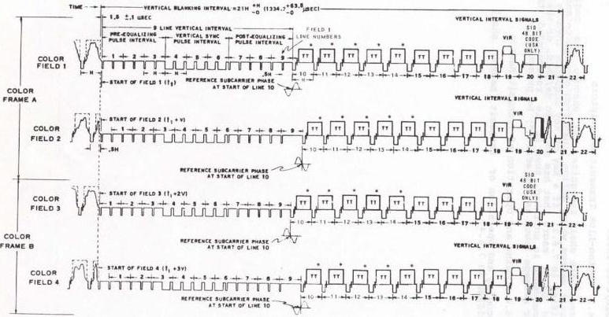

*FIGURE 1 – COMPOSITE VIDEO SIGNAL*

NOTE: LINE 20 MAY ALSO BE USED FOR TELETEXT ON BOTH FIELDS

TT = TELETEXT

* = POTENTIAL TELETEXT

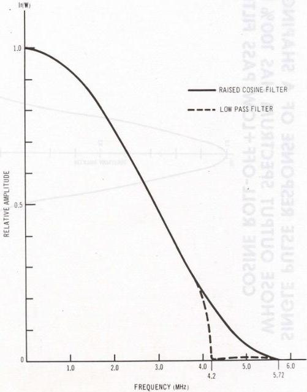

*FIGURE 2 – LOW PASS FILTERED / 100% RAISED COSINE SPECTRUM*

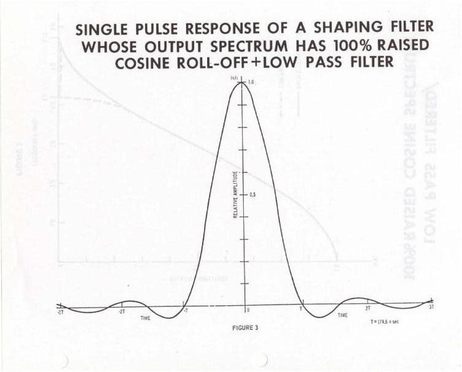

*FIGURE 3 – IMPULSE RESPONSES*

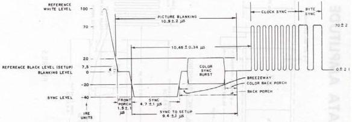

*FIGURE 4 – DATA TIMING: HORIZONTAL SYNC & BLANKING*

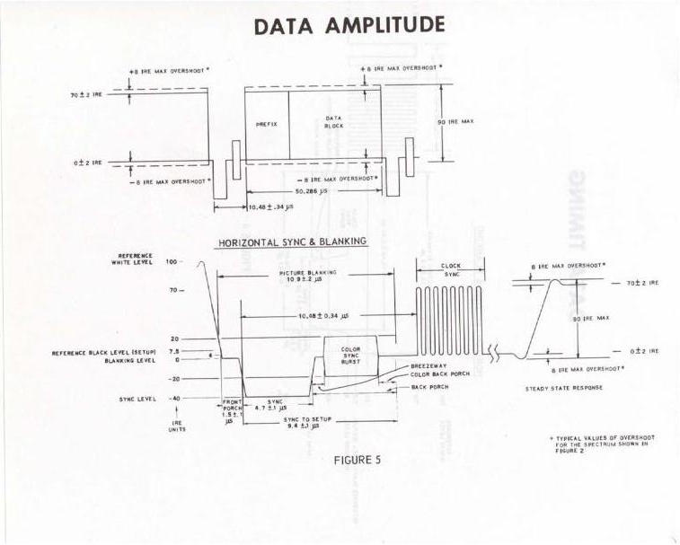

*FIGURE 5 – DATA AMPLITUDE*

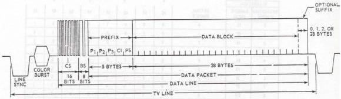

*FIGURE 6 – DATA LINE STRUCTURE*

HAMMING CODE

|  HEXADECIMAL |   | DECIMAL NUMBER | INFORMATION BITS  |   |   |   |   |   |   |   |
| --- | --- | --- | --- | --- | --- | --- | --- | --- | --- | --- |
|  INFORMATION NUMBER | HAMMING VALUE |   | b8 | b7 | b6 | b5 | b4 | b3 | b2 | b1  |
|  0 | 15 | 0 | 0 | 0 | 0 | 1 | 0 | 1 | 0 | 1  |
|  1 | 02 | 1 | 0 | 0 | 0 | 0 | 0 | 0 | 1 | 0  |
|  2 | 49 | 2 | 0 | 1 | 0 | 0 | 1 | 0 | 0 | 1  |
|  3 | 5E | 3 | 0 | 1 | 0 | 1 | 1 | 1 | 1 | 0  |
|  4 | 64 | 4 | 0 | 1 | 1 | 0 | 0 | 1 | 0 | 0  |
|  5 | 73 | 5 | 0 | 1 | 1 | 1 | 0 | 0 | 1 | 1  |
|  6 | 38 | 6 | 0 | 0 | 1 | 1 | 1 | 0 | 0 | 0  |
|  7 | 2F | 7 | 0 | 0 | 1 | 0 | 1 | 1 | 1 | 1  |
|  8 | DΦ | 8 | 1 | 1 | 0 | 1 | 0 | 0 | 0 | 0  |
|  9 | C7 | 9 | 1 | 1 | 0 | 0 | 0 | 1 | 1 | 1  |
|  A | 8C | 10 | 1 | 0 | 0 | 0 | 1 | 1 | 0 | 0  |
|  B | 9B | 11 | 1 | 0 | 0 | 1 | 1 | 0 | 1 | 1  |
|  C | A1 | 12 | 1 | 0 | 1 | 0 | 0 | 0 | 0 | 1  |
|  D | B6 | 13 | 1 | 0 | 1 | 1 | 0 | 1 | 1 | 0  |
|  E | FD | 14 | 1 | 1 | 1 | 1 | 1 | 1 | 0 | 1  |
|  F | EA | 15 | 1 | 1 | 1 | 0 | 1 | 0 | 1 | 0  |

b7 = b8 @ b6 @ b4

b5 = b6 @ b4 @ b2

b3 = b4 @ b2 @ b8

b1 = b2 @ b8 @ b6

DECODING

A = b8 @ b6 @ b2 @ b1

B = b8 @ b4 @ b3 @ b2

C = b6 @ b5 @ b1 @ b2

D = b8 @ b7 @ b6 @ b5 @ b4 @ b3 @ b2 @ b1

\(\theta =\) EXCLUSIVE-OR

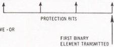

*FIGURE 7 – HAMMING CODE*

|  A | B | C | D | INTERPRETATION | INFORMATION  |
| --- | --- | --- | --- | --- | --- |
|  1 | 1 | 1 | 1 | NO ERROR | ACCEPTED  |
|  0 | 0 | 1 | 0 | ERROR IN b8 | CORRECTED  |
|  1 | 1 | 1 | 0 | ERROR IN b7 | ACCEPTED  |
|  0 | 1 | 0 | 0 | ERROR IN b6 | CORRECTED  |
|  1 | 1 | 0 | 0 | ERROR IN b5 | ACCEPTED  |
|  1 | 0 | 0 | 0 | ERROR IN b4 | CORRECTED  |
|  1 | 0 | 1 | 0 | ERROR IN b3 | ACCEPTED  |
|  0 | 0 | 0 | 0 | ERROR IN b2 | CORRECTED  |
|  0 | 1 | 1 | 0 | ERROR IN b1 | ACCEPTED  |
|  A,B,C = 0 |   |   | 1 | MULTIPLE ERRORS | REJECTED  |

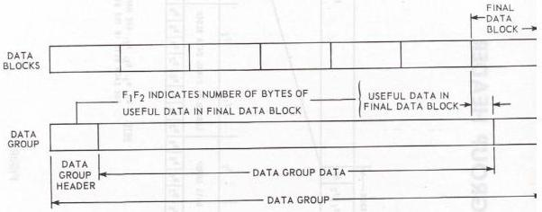

*FIGURE 8 – DATA GROUP*

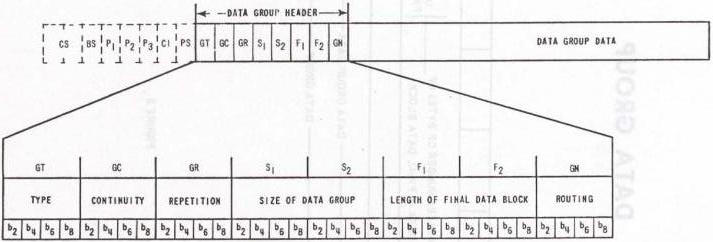

*FIGURE 9 – DATA GROUP HEADER*

GT = TYPE OF DATA GROUP

GC = DATA GROUP CONTINUITY

GR = REPETITION COUNTER

S = SIZE OF DATA GROUP

F = LENGTH OF FINAL DATA BLOCK

GN = BROADCAST NETWORK ROUTING

NOTE: - b₁, b₃, b₅, b₇, ARE HAHMING PROTECTION BITS FOR EACH BYTE IN THE DATA GROUP HEADER.

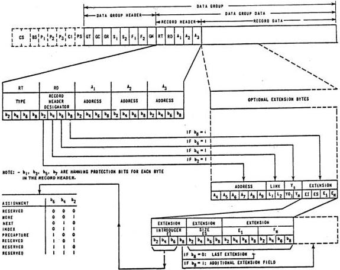

*FIGURE 10 – RECORD HEADER*

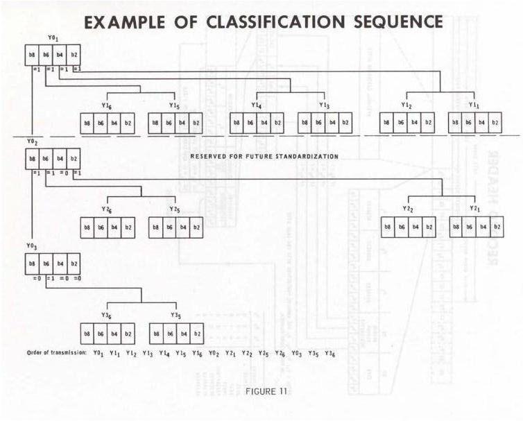

*FIGURE 11 – EXAMPLE OF CLASSIFICATION SEQUENCE*

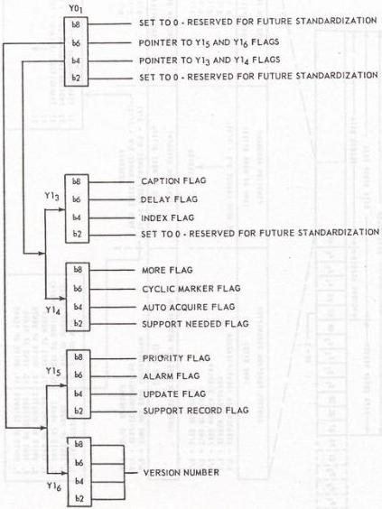

*FIGURE 12 – FUNDAMENTAL SERVICE CLASSIFICATION SEQUENCE*

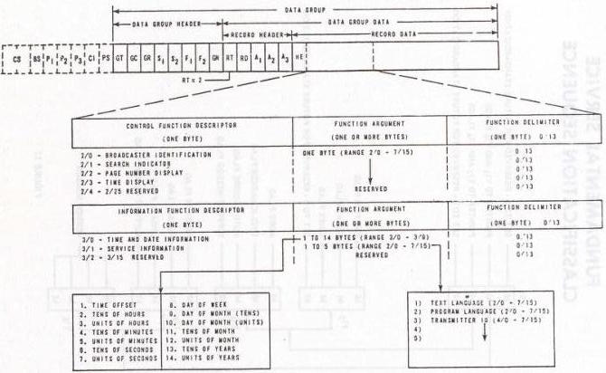

*FIGURE 13 – APPLICATION RECORD STRUCTURE*

## APPENDIX A: GLOSSARY

Alarm Record is a Record of Record Type 3, with the Alarm and Priority Flags set to 1. This Record shall be processed by receivers, see 7.3.14.

Application Record is a Record of Record Type 2, which contains application information that may be used by the receiver and control data to control the operation of the receiver, see 5.2.2.4 and 7.2.

Bundle is a number of Data Blocks terminated by, and including, one or more zero-length Data Blocks in packets with 28-byte suffixes, see 3.4.

Border is the area of the physical display screen that is outside the Display Area.

Caption Record is a Record with the Caption Flag set to 1. It may be used to initialize the captioning service, see 5.2.7.3.

Captioning is a program-related Message that is transmitted to the receiver and overlaid on the program video, see 7.3.10.

Classification Sequence is a variable number of Hamming-encoded bytes in the Record Header. The Classification Sequence bytes are of two types: pointer bytes, which indicate the presence or absence of additional bytes, and flag bytes, which convey information about the Record to the receiver, see 5.2.7.

Continuity Index is the fourth Hamming-encoded byte of the Packet Prefix. Each time a Data Packet is transmitted within a given Data Channel, the Continuity Index increments by one. The continuity Index is used to detect the loss of a Data Packet in a Data Group, see 3.2.4

Cyclic Marker Record is a Record of Record Type 3 with the Cyclic Marker Flag set to 1, see 5.2.7.7. The Cyclic Marker Record is the first Record in a cycle of Records in a Data Channel in a cyclic teletext service, see 7.1.2.

Data Block is the group of bytes in a Data Packet that follow the Packet Prefix and precede the Suffix, if any, see 3.3.

Data Channel is a data communications channel defined by the Packet Address, see 3.2.3. See also the definition of Magazine.

Data Group is an integral number of Data Blocks transported in Data Packets characterized by a given value of the same Packet Address, see 4.1.

Data Group Data is that part of a Data Group that follows the Data Group Header, see 4.3.

Data Group Header is the first part of a Data Group, see 4.2.

Data Group Repetition is the number of times that the Data group will be repeated, see 4.2.4

Data Line is that part of a TV Line that contains digital information. A Data Line contains 288 bits divided into a Synchronization Sequence and a Data Packet, see 2.1.

Data Packet is the set of 33 eight-bit bytes that follow the Synchronization Sequence in the Data Line. The Data Packet consists of the Packet Prefix, the Data Block and the optional Suffix, see 3.1

Display Area is the rectangular part of the physical display screen in which information coded in conformance with NAPLPS is displayed. The Display Area does not include the Border Area.

Flash is a function used to present information to a user upon request while the user is watching a TV program, see 7.3.12.

Framing Code consists of bits 17 through 24 of the Synchronization Sequence. It is used as a reference for byte synchronization, see 2.2.3.

Hamming is an error protection technique that can detect and correct errors in digital transmission systems, see 3.2.2 and Figure 7.

Header Extension Data is part of the Header Extension Field, see 5.2.8.4.

Header Extension Field is part of the Record Header see 5.2.8.

Header Extension Introducer Byte is part of the Header Extension Field, see 5.2.8.2.

Header Extension Size Byte is part of the Field, see 5.2.8.3.

Hexadecimal is a numbering system based on 16 with digits 0, 1, 2, 3, 4, 5, 6, 7, 8, 9, A, B, C, D, E and F.

Index Page is a Page with the Index Flag set to 1 in the first Record, see 5.2.7.5 and 7.3.6.

IRE Standard Scale is a linear scale for measuring the relative amplitudes of the components of a television signal from a zero reference at blanking level. Picture information falls in the range from 0 to 100 IRE units, and synchronizing information lies in the range from 0 to -40 IRE units.

Magazine is a grouping of Pages transmitted in a single Data Channel. Magazine number is used when considering user access, and Data Channel number is used when considering the structure of the broadcast data.

Main Index Page is the top level Index Page, see 7.3.6. This is normally identical to the Master Index Page, but the service provider could choose some other Page using the Header Extension Fields.

Marker Record is a Record with the Cyclic Marker Flag set to 1, see 5.2.7.7.

Master Index Page is the Message with Record Address 0 in Data Channel 0, see 7.3.6.

Message is either a single unlinked Record or a linked series of Records, see 5.2.6.

Mode is the state of the receiver as defined in 5.2.7.10.

More Record is a Record that provides more detail on the same topic, see 7.3.4.

NAPLPS is the joint ANSI (BSR X3.110)/CSA (T500) Standard "Videotex/Teletext Presentation Level Protocol Syntax (North American PLPS)", 1983.

Next Record is a Record that provides information on the next topic, see 7.3.3.

NRZ is Non Return to Zero, which is a method of coding data with no state transitions within the duration of a single bit.

Packet Address is the address of a Data Packet as defined by the first three bytes of the Packet Prefix, see 3.2.3.

Packet Prefix *is* the first part of the Data Packet, see 3.2.

Packet Structure Byte is the fifth byte of the Packet Pre- fix. It specifies the type of Data Packet, whether the Data Packet is full, and the length of the Suffix, see 3.2.5.

Page is a group of characters and pictorial information that is intended for display as an entity on a Receiver. It consists of either an unlinked Presentation Record (see 5.2.2.2) or a linked series of Records (a Message) containing at least one Presentation Record, see 7.1.1. The Page number is the Record Address or the user access form of the Record Address, see 8.5.2.5.

Parity is the oddness or evenness of the number of logical 1 bits. In teletext, odd parity *is* used and defined as an odd number of logical 1 bits *in* each 8-bit byte.

Presentation Record is a Record of Record Types 0,1 or 3. It contains code conforming to the NAPLPS and intended for display, see 5.2.2 and 6.1.

Priority Record *is* a Record of Record Type 3 with the Alarm Flag set to 0 and the Priority Flag set to 1. It is used for VPE, see 7.3.11.

Receiver is an electronic device used to receive, decode and present teletext information coded and transmitted according to this Specification.

Record is a unit of Data Group Data from a single Data Group, see 5.1. In this document it is taken to be synonymous with Teletext Record.

Record Address, also known as Page Number, is a sequence of three bytes in the Record Header, plus an optional six bytes in the Record Address Extension, that partially identify a Record, see 5.2.4. If there is no Record Address Extension, then the three Record Address bytes constitute a Short Record Address, otherwise the three Record Address bytes plus the six Record Address Extension bytes together constitute a Long Record Address.

Record Address Extension is six bytes in the Record Address Extension that are part of the Long Record Address, see 5.2.5.

Record Data is that part of a Record following the Record Header, see 5.3.

Record Header is the first part of a Record. It identifies the Record and contains information about the Record, see 5.2.

Record Header Designator is a byte *in* the Record Header that indicates the presence of one or more optional subgroups, see 5.2.3.

Record Link is two bytes *in* the Record Header that link together Records identified by the same Record Address, see 5.2.6.

Record Type is the first byte in the Record Header defines different types of Record, see 5.2.2.

Reveal Record is a Record of Record Type 3 with the Alarm Flag set to 1 and the Priority Flag set to 0. When a Reveal Record is received, then the last Record received with the Delay Flag set to 1 is presented, see 5.2.7.4.

Rolling Record, also called a Rolling page, is one of a set of Records with the same Record Address with the Update Flag set to 1, but with sequenced Version Numbers, see 7.3.2. A set of Rolling Records constitutes a Sub-Cycle.\

Service Application Record is an Application Record at Record Address FFE in Data Channel 0 which contains information function descriptors relating to the service that may optionally be used by the receiver such as date, time, language, and transmitter identification, see 7.2.1.

Standard Packet is a Data Packet in which bit b2 of the Packet Structure Byte is 0, see 3.2.5.

Suffix is the last part of the Data Packet. It contains error protection code, see 3.4.

Support Record is a Record with the Support Record Flag set to 1 and Record Address FFF. It contains data that is used by other Records, see 5.2.7.9, 5.2.7.12 and 7.1.4.

Synchronization Sequence is the first part of the Data Line. It consists of 24 bits divided into a 16-bit Clock Synchronization Sequence and an 8-bit Framing Code, see 2.2.

Synchronizing Packet is a Data Packet in which bit b2 of the Packet Structure Byte is 1, and which starts a Data Group, see 3.2.5 and 4.1.

Teletext Record is a Record for which GT = 0, see 4.2.2.

TV Line is one of the 525 lines that constitute a TV frame.

Vertical Blanking Interval (VBI) is the interval at the beginning of a TV field during which TV picture information is not present. Receivers perform vertical retrace during VBI.

Video Program Enhancement (VPE) is a function used to present information to a user without intervention while the user is watching a TV program, see 7.3.11.

## STANDARD

A document that establishes engineering and technical requirements for processes, procedures, practices and methods that have been decreed by authority or adopted by consensus. Standards may also be established for selection, application and design criteria for material.

Standards and other documents not in the specification format use only the EIA basic numbering system as follows:

EIA-123 Original Standard

EIA-123-1 Addendum to the Original Standard

EIA-123-A First Revision of original standard incorporating all Addenda

## SPECIFICATION

A document prepared specifically to facilitate procurement which clearly and accurately describes the essential technical requirements for purchased material. Procedures necessary to determine that the requirements for the purchased material covered by .the specification have been met shall also be referenced or included.

ETA Specifications use the following system:

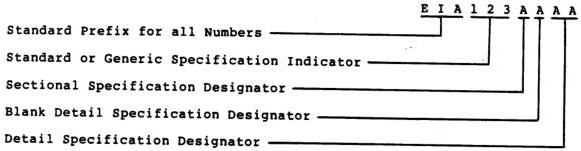

|  EIA | 123ØØØØ | is a Generic Specification  |
| --- | --- | --- |
|  EIA | 123AØØØ | is a Sectional Specification  |
|  EIA | 123AAØØ | is a Blank Detail Specification  |
|  EIA | 123AAAA | is a Detail Specification  |

EIA 123ØØAA is a Detail Specification for which no Sectional or Blank Detail Specification was issued

Notes 1. Some older specifications may not have been converted to this numbering system

2. See EP-11, "Guide for the Preparation of Specifications Using IECQ-System Format," for more detail.
